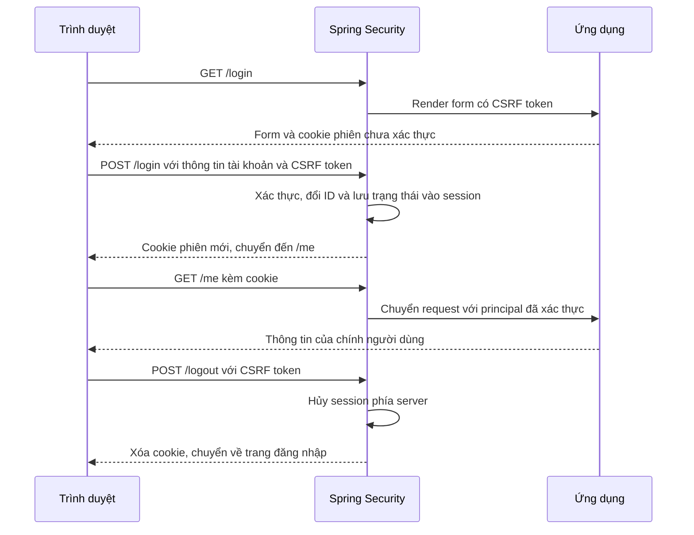

# Session Hijacking Lab — Nhóm 05

Ứng dụng quản lý ghi chú nhỏ cho đồ án An toàn mạng máy tính: đăng nhập bằng Spring Security, xác thực các request tiếp theo bằng cookie session, xem dữ liệu cá nhân và đăng xuất.

Phần 1 xây dựng ứng dụng; phần 2 bổ sung bản HTTPS và quản lý vòng đời phiên theo [bản phân công](../PHAN_CONG_SESSION_HIJACKING.md). Phần 3 đã bắt gói thật bằng tcpdump/TShark và đối chiếu HTTP/HTTPS, đạt T01–T09.

Tài liệu chính: [giới thiệu repository](../README.md), [báo cáo tổng hợp ATMMT_nhom05](docs/ATMMT_nhom05.md) và [hướng dẫn bàn giao nhóm 05](docs/BAN_GIAO_NHOM05.md). Kết quả chạy lại từ mã nguồn sạch và log đã che mã phiên được liên kết trong tài liệu bàn giao.

## 1. Công nghệ và phạm vi

| Thành phần | Phiên bản/lựa chọn |
|---|---|
| Java | 17 trở lên; mức biên dịch Java 17 |
| Spring Boot | 4.1.1 |
| Maven Wrapper | Maven 3.9.16, Wrapper 3.3.4 |
| Web | Spring MVC, embedded Tomcat |
| Bảo mật | Spring Security, form login, session Servlet |
| Giao diện | Thymeleaf, CSS và JavaScript cục bộ, không có thư viện frontend |
| Lưu trữ | Tài khoản và ghi chú mẫu trong bộ nhớ |

Spring Boot quản lý phiên bản dependency Spring/Thymeleaf; xem `pom.xml` để biết dependency trực tiếp. Không cần cài database hoặc Maven toàn cục. Nếu chạy bằng Docker theo mục 2, máy chỉ cần Docker và Compose; JDK trên máy không tham gia build/chạy container.

Ứng dụng có hai cấu hình **chỉ dành cho lab cục bộ**: `http-lab` tại `http://127.0.0.1:8080` và `https` tại `https://127.0.0.1:8443`. Không đặt cả hai profile hoạt động trong cùng tiến trình. Bản HTTPS chạy riêng, dùng cookie `Secure` và timeout không hoạt động 1 phút để demo; HTTP mặc định vẫn giữ timeout 20 phút. Cả hai giữ `HttpOnly`, `SameSite=Lax`, CSRF và chống Session Fixation. Không dùng dữ liệu hoặc tài khoản thật.

### Giao diện và phạm vi tương tác

- Nhận diện “ghi chú.”: nền giấy sáng, xanh đậm, thẻ ghi chú xanh nhạt và màu cát. Font hệ thống hỗ trợ tiếng Việt, icon SVG và minh họa CSS cục bộ; không gọi dịch vụ font/ảnh bên ngoài.
- Trang chủ giới thiệu ứng dụng; trang đăng nhập có form, hiện/ẩn mật khẩu và phản hồi lỗi/thành công. Trang tài khoản và ghi chú dùng chung điều hướng, đánh dấu trang đang mở.
- Trên màn hình nhỏ, điều hướng chuyển lên đầu trang; ghi chú xếp một cột. Tablet và desktop sử dụng bố cục phù hợp khoảng trống còn lại.
- Tìm kiếm lọc tiêu đề và nội dung của các ghi chú **đã được server render cho chính tài khoản hiện tại**, hỗ trợ có/không dấu. Không gửi request tìm kiếm và không thay đổi quyền truy cập.
- Có trạng thái không có ghi chú, tìm kiếm không có kết quả, xóa tìm kiếm, focus bàn phím và trạng thái đang gửi form. CSS tôn trọng `prefers-reduced-motion`.
- Nếu JavaScript không chạy, đăng nhập/đăng xuất và đọc ghi chú vẫn hoạt động. Các nút tìm kiếm và hiện mật khẩu chỉ xuất hiện khi JavaScript đã khởi tạo.
- Dữ liệu mẫu vẫn tập trung tại `NoteService`; chưa bổ sung tạo, sửa, xóa ghi chú. Không hiển thị các nút cho nghiệp vụ chưa có.

## 2. Chạy bằng Docker — Cách dùng chung cho nhóm

Docker Desktop phải đang chạy với Linux containers. Kiểm tra trước:

```powershell
docker version
docker compose version
```

Trong PowerShell, chuyển vào thư mục project của bản clone. Ví dụ nếu terminal đang ở thư mục gốc repository `ATMMT`:

```powershell
cd .\session-hijacking-lab
docker compose up --build -d
docker compose logs -f app
```

Chờ log báo Tomcat đã khởi động, rồi mở **http://127.0.0.1:8080**. `Ctrl+C` ở lệnh theo dõi log chỉ dừng xem log, container vẫn chạy.

Lần build đầu cần Internet để tải image và Maven dependency. Dockerfile build từ mã nguồn bằng JDK 17, chạy bộ kiểm tra HTTP, rồi chỉ đưa executable JAR sang image JRE 17. Tiến trình ứng dụng chạy bằng UID/GID `10001:10001`, không chạy bằng root.

Container lắng nghe trên `0.0.0.0` bên trong mạng Docker để nhận kết nối từ port mapping. Compose chỉ publish `127.0.0.1:8080` trên máy host, phù hợp lab cục bộ. Mở bằng địa chỉ host ở trên, không dùng IP nội bộ của container.

Các lệnh thường dùng:

```powershell
docker compose ps
docker compose logs --tail 50 app
docker compose exec app java -version
docker compose stop
docker compose start
docker compose down
```

`stop` dừng ứng dụng; `start` chạy lại container đã dừng. `down` dừng và xóa container/network của riêng Compose project này. Session trong bộ nhớ mất sau mỗi lần tiến trình ứng dụng khởi động lại. Khi sửa mã nguồn, chạy lại `docker compose up --build -d`; chỉ restart container không nạp mã mới.

Nếu cổng 8080 đang bận, chọn cổng host khác:

```powershell
$env:LAB_PORT = "8081"
docker compose up --build -d
```

Mở `http://127.0.0.1:8081`. Dùng cùng giá trị `LAB_PORT` khi thao tác Compose ở terminal khác. Không chạy đồng thời bản Maven và bản Docker trên cùng cổng host.

Image hiện cố định Java major 17 và Ubuntu Jammy qua tag Temurin. Tag có thể nhận các bản vá Java 17 mới; Docker giúp tách biệt JDK trên host, nhưng không phải cam kết image bất biến theo thời gian. Nếu nhóm cần tái lập đúng từng image, có thể chốt digest của bản đã kiểm chứng sau.

### Nếu Docker Desktop lỗi `sailor-ingest.sock` trên Windows

Máy này đã gặp lỗi `The file cannot be accessed by the system` khi khởi động Docker Desktop từ Codex. Mở Docker Desktop trực tiếp từ Start Menu hoặc Windows Explorer đã giúp engine khởi động lại thành công. Sau khi engine sẵn sàng mới chạy các lệnh Compose trong Codex.

Có [báo cáo lỗi tương ứng trong repository Codex](https://github.com/openai/codex/issues/52698) về việc truy cập socket trong AppData từ tiến trình mang ngữ cảnh MSIX. Đây là báo cáo cộng đồng, không phải cam kết mọi lỗi socket đều cùng nguyên nhân. Việc khởi động thành công ngoài Codex là bằng chứng thực tế trên máy này.

Không cần reset dữ liệu Docker để xử lý tình huống đã kiểm chứng này.

### Chạy bản HTTPS — Phần 2

Thực hiện tại thư mục `session-hijacking-lab`. Máy hiện có JDK 17 và `keytool`; chỉ bước tạo chứng chỉ và chạy công cụ kiểm chứng cần JDK trên host, ứng dụng vẫn build/chạy trong Docker.

**1. Tạo chứng chỉ riêng cho máy này (một lần):**

```powershell
.\scripts\New-LabCertificate.ps1
```

Script tạo chứng chỉ tự ký RSA 3072/SHA-256, SAN `localhost` và `127.0.0.1`, mục đích TLS server, hạn 30 ngày. Không cài chứng chỉ vào Windows và không ghi đè khóa đã tồn tại. Các file cục bộ:

| File | Nội dung | Chia sẻ? |
|---|---|---|
| `.local/tls/localhost.cer` | Chứng chỉ công khai | Có thể đưa cho client lab, đối chiếu fingerprint qua kênh tin cậy |
| `.local/tls/localhost.p12` | Khóa riêng và chứng chỉ server | Không chia sẻ |
| `.local/tls/runtime.env` | Mật khẩu keystore ngẫu nhiên | Không chia sẻ |

`.local/` bị loại khỏi Git và Docker build context; PKCS12 chỉ được mount read-only khi chạy container. Mật khẩu không nằm trong mã nguồn hoặc tham số command line. Docker vẫn cho người có quyền quản trị Docker đọc biến môi trường; đây không phải secret manager dùng cho production. Giữ thư mục dự án trên tài khoản Windows riêng, không đặt trong thư mục chia sẻ công khai.

Mỗi thành viên tự tạo chứng chỉ trên máy mình. Khi hết hạn, dừng container, lưu trữ bộ chứng chỉ cũ ở nơi riêng nếu cần rồi tạo bộ mới; script cố ý không tự xóa hoặc ghi đè. Việc tin cậy chứng chỉ cũ không tự áp dụng cho chứng chỉ mới.

**2. Khởi động server HTTPS:**

```powershell
docker compose -f compose.https.yaml up --build -d
docker compose -f compose.https.yaml logs --tail 40 app
```

URL: **https://127.0.0.1:8443**. Bản HTTPS không thêm connector HTTP. Nếu mở nhầm `http://127.0.0.1:8443`, ứng dụng không phục vụ trang đăng nhập qua HTTP; không có redirect từ HTTP sang HTTPS ở cổng này.

Hai file Compose là hai project độc lập; không ghép chúng bằng hai tùy chọn `-f` trong cùng lệnh. Có thể chạy cả hai để so sánh, nhưng cần tạo phiên mới ở từng bản. Cookie HTTP không được dùng làm cookie xác thực HTTPS và ngược lại. Cookie không bị cô lập theo số cổng: việc tách tên cookie và bộ nhớ server riêng là chủ đích cần hiểu khi demo.

| Cấu hình | HTTP lab | HTTPS lab |
|---|---|---|
| Compose | `compose.yaml` | `compose.https.yaml` |
| Profile | `http-lab` (mặc định khi không chọn profile) | `https` |
| URL host | `http://127.0.0.1:8080` | `https://127.0.0.1:8443` |
| Cookie | `JSESSIONID` | `__Host-LABSESSION_HTTPS` |
| `Secure` | Không | Có |
| `HttpOnly` / `SameSite` | Có / Lax | Có / Lax |
| Path / Domain | `/` / không khai báo | `/` / không khai báo |
| Timeout không hoạt động | 20 phút | 1 phút (chỉ để demo) |
| Lưu trữ session | Riêng trong tiến trình HTTP | Riêng trong tiến trình HTTPS |

Tiền tố `__Host-` yêu cầu cookie `Secure`, `Path=/` và không có `Domain` ở trình duyệt hỗ trợ. Giữ nguyên các thuộc tính này khi tích hợp phần 3. Đổi hostname cần chứng chỉ có SAN đúng; chứng chỉ hiện tại không dành cho IP LAN hoặc tên miền khác.

**3. Client xác minh TLS đúng cách:**

Công cụ Java của nhóm tin cậy **chỉ chứng chỉ công khai được chỉ định cho lần chạy**, vẫn xác minh TLS và hostname, không sửa trust store toàn máy:

```powershell
java scripts/VerifyHttpsLab.java .local/tls/localhost.cer
```

Lệnh kiểm tra đăng nhập, thuộc tính cookie, CSRF, đổi mã phiên, cookie cũ, logout và timeout; chờ 75 giây không phát request từ cả hai client kiểm tra timeout. Dừng auto-refresh/trang đang dùng cùng phiên khi demo thủ công. Công cụ dùng session độc lập với trình duyệt, không in giá trị cookie hoặc mật khẩu.

Nếu đổi cổng bằng `LAB_HTTPS_PORT`, truyền URL tương ứng:

```powershell
java scripts/VerifyHttpsLab.java .local/tls/localhost.cer https://127.0.0.1:8444
```

**Trình duyệt trên Windows:** chứng chỉ tự ký chưa được hệ điều hành tin cậy nên trình duyệt có thể cảnh báo. Để demo không bỏ qua xác minh TLS, đối chiếu thumbprint của `.cer` với kết quả script, rồi người dùng chủ động nhập **đúng chứng chỉ công khai đó** vào `CurrentUser\Root` (Trusted Root Certification Authorities của tài khoản hiện tại). Đây là thay đổi phạm vi tin cậy của Windows; không nhập file chứng chỉ không rõ nguồn và không nhập `.p12` vào kho Root.

```powershell
# Người dùng thực hiện sau khi đã đối chiếu thumbprint:
Import-Certificate -FilePath .local\tls\localhost.cer -CertStoreLocation Cert:\CurrentUser\Root
```

Đóng/mở lại trình duyệt nếu cần. Edge/Chrome thường dùng trust store Windows; trình duyệt có kho tin cậy riêng cần nhập đúng `.cer` theo cơ chế của nó. Không dùng `curl -k`, trust-all hoặc nút bỏ qua cảnh báo làm cách chạy mặc định. Công cụ Java ở trên hoạt động mà không cần bước nhập Windows này.

Kết thúc lab, có thể gỡ **đúng chứng chỉ** đã nhập (không xóa cả kho Root):

```powershell
$labCertificate = [System.Security.Cryptography.X509Certificates.X509Certificate2]::new(
    (Resolve-Path .local\tls\localhost.cer).Path)
Get-Item -LiteralPath "Cert:\CurrentUser\Root\$($labCertificate.Thumbprint)"
# Sau khi xác nhận đúng chứng chỉ lab:
Remove-Item -LiteralPath "Cert:\CurrentUser\Root\$($labCertificate.Thumbprint)"
```

**Dừng HTTPS:**

```powershell
docker compose -f compose.https.yaml stop
```

**Chạy HTTPS trực tiếp bằng JDK — tùy chọn:**

```powershell
$tlsSetting = Get-Content .local\tls\runtime.env | Where-Object { $_.StartsWith('LAB_TLS_PASSWORD=') }
$env:LAB_TLS_PASSWORD = $tlsSetting.Substring('LAB_TLS_PASSWORD='.Length)
.\mvnw.cmd spring-boot:run "-Dspring-boot.run.profiles=https"
# Sau khi dừng server:
Remove-Item Env:\LAB_TLS_PASSWORD
```

Giữ một profile hoạt động cho mỗi tiến trình. Không thiết lập `LAB_TLS_PASSWORD` toàn cục trên máy.

## 3. Chạy trực tiếp trên Windows — Tùy chọn không dùng Docker

Từ thư mục gốc repository `ATMMT`, mở PowerShell:

```powershell
cd .\session-hijacking-lab
java -version
javac -version
.\mvnw.cmd spring-boot:run
```

Lần đầu cần Internet để tải Maven/dependency. Wrapper dùng Java đang cấu hình trên máy; nếu báo lỗi JDK, đặt `JAVA_HOME` trỏ đến thư mục JDK thực tế hoặc chọn JDK trong IDE.

Mở **http://127.0.0.1:8080**. Dùng nhất quán hostname `127.0.0.1` khi demo để tránh nhầm cookie giữa các hostname. Dừng ứng dụng bằng `Ctrl+C` tại terminal chạy server.

Nếu cổng 8080 đang được sử dụng:

```powershell
.\mvnw.cmd spring-boot:run "-Dspring-boot.run.arguments=--server.port=8081"
```

Khi đó mở `http://127.0.0.1:8081`.

Trên macOS/Linux dùng `./mvnw` thay cho `.\mvnw.cmd`; nếu cần, cấp quyền thực thi bằng `chmod +x mvnw`.

## 4. Tài khoản thực hành

| Tên đăng nhập | Mật khẩu lab |
|---|---|
| `alice` | `AliceLab!2026` |
| `bob` | `BobLab!2026` |

Đây là thông tin mẫu công khai, cố ý dùng riêng cho lab. Mật khẩu được mã hóa bằng `PasswordEncoder` trước khi đưa vào kho tài khoản trong bộ nhớ. Không tái sử dụng các mật khẩu này cho tài khoản thật.

Tắt hoặc khởi động lại server sẽ mất các session hiện tại. Ghi chú là dữ liệu chỉ đọc, được nạp lại từ mã nguồn; ứng dụng chưa có tạo/sửa/xóa ghi chú.

## 5. Các đường dẫn để bàn giao

| Phương thức và đường dẫn | Chức năng | Hành vi |
|---|---|---|
| `GET /` | Trang chủ | Công khai |
| `GET /login` | Form đăng nhập | Công khai; có CSRF token |
| `POST /login` | Xử lý đăng nhập | Spring Security xử lý; cần CSRF token |
| `GET /me` | Danh tính đã xác thực | Chưa đăng nhập thì chuyển đến `/login` |
| `GET /notes` | Ghi chú của chính người dùng | Chọn chủ sở hữu từ principal phía server |
| `POST /logout` | Đăng xuất | Cần CSRF token; hủy session và xóa cookie |
| `GET /css/app.css` | Stylesheet | Công khai |
| `GET /js/app.js` | Tương tác giao diện | Công khai |

Đăng nhập thành công luôn chuyển đến `/me`. Đăng nhập sai chuyển đến `/login?error` với thông báo chung. Logout thành công chuyển đến `/login?logout`.

`GET /logout` có thể hiển thị trang xác nhận của Spring Security; bản thân GET không đăng xuất. Nút trong ứng dụng gửi POST với CSRF token do Thymeleaf chèn vào form.

## 6. Cấu trúc mã nguồn

```text
src/main/java/vn/edu/atmmt/sessionlab/
  SessionHijackingLabApplication.java  Điểm khởi động
  config/SecurityConfig.java          Tài khoản, encoder, phân quyền và form login
  web/PageController.java             Trang chủ, login, me, notes
  notes/Note.java                     Dữ liệu một ghi chú
  notes/NoteService.java              Ghi chú chỉ đọc, chia theo chủ sở hữu
src/main/resources/
  application.properties             Địa chỉ, cổng và cấu hình session
  application-http-lab.properties    Profile HTTP dành cho đối chiếu
  application-https.properties       TLS, cookie riêng và timeout demo
  templates/                         Trang HTML và fragment dùng chung
  static/css/app.css                 CSS cục bộ
  static/js/app.js                   Tìm kiếm, hiện mật khẩu và trạng thái gửi form
scripts/
  New-LabCertificate.ps1             Tạo chứng chỉ và khóa riêng cục bộ
  VerifyHttpsLab.java                Kiểm chứng HTTPS và vòng đời phiên bằng JDK 17
compose.https.yaml                   Server HTTPS riêng, mount PKCS12 read-only
src/test/java/vn/edu/atmmt/sessionlab/
  SessionHijackingLabApplicationTests.java
```

Không có endpoint trả session ID. `/me` chỉ hiển thị danh tính, không hiển thị cookie hoặc CSRF token thành nội dung trang cho người dùng. CSRF token vẫn nằm trong hidden input của form theo cơ chế thông thường.

## 7. Luồng hoạt động cần hiểu khi bảo vệ

1. Trình duyệt mở `/login`. Form được render cùng CSRF token, có thể tạo phiên chưa đăng nhập.
2. Trình duyệt POST tên đăng nhập, mật khẩu, CSRF token và cookie tương ứng.
3. Spring Security kiểm tra thông tin tài khoản bằng `PasswordEncoder`.
4. Khi đăng nhập thành công, cơ chế chống fixation đổi session ID và lưu trạng thái xác thực trong session phía server.
5. Trình duyệt giữ cookie `JSESSIONID` ở bản HTTP, hoặc `__Host-LABSESSION_HTTPS` ở bản HTTPS; các request sau gửi cookie để server tìm lại phiên đã xác thực.
6. `/me` và `/notes` lấy tên người dùng từ principal. Tham số như `?username=bob` không đổi chủ sở hữu dữ liệu.
7. POST logout hợp lệ hủy session phía server. Client khác giữ bản sao cookie cũ cũng mất quyền truy cập bằng phiên đó.



Ứng dụng có cookie `HttpOnly` vẫn có thể bị giả danh nếu cookie hợp lệ đã lộ từ nguồn khác. `HttpOnly` chặn JavaScript đọc cookie, không chặn DevTools hoặc người đã có giá trị cookie gửi lại nó.

## 8. Kiểm tra thủ công phần của bạn

| Bước | Thao tác | Kết quả cần đạt |
|---|---|---|
| 1 | Browser profile A chưa đăng nhập, mở `/me` và `/notes` | Chuyển đến đăng nhập |
| 2 | Đăng nhập `alice` | `/me` hiển thị `alice` |
| 3 | Mở `/notes` | Chỉ có ghi chú của Alice |
| 4 | Mở `/notes?username=bob` khi đang là Alice | Vẫn chỉ có ghi chú của Alice |
| 5 | Browser profile B độc lập đăng nhập `bob` | `/me` hiển thị `bob`, ghi chú thuộc Bob |
| 6 | Đăng nhập sai mật khẩu | Thông báo chung, không truy cập được trang riêng |
| 7 | Nhấn Đăng xuất, mở lại `/me` | Phải đăng nhập lại |
| 8 | DevTools → Network/Application, quan sát cookie | Xác định được `JSESSIONID`, `HttpOnly`, `SameSite=Lax` |

Hai tab trong cùng browser profile thường chia sẻ cookie. Dùng hai browser profile độc lập hoặc hai trình duyệt khác nhau cho hai danh tính.

Trong phần lab tiếp theo, nhóm có thể mô phỏng client thứ hai giữ bản sao cookie của tài khoản giả để minh họa tác động. Phải phân biệt việc sao chép thủ công bằng DevTools với việc quan sát cookie bị lộ trong lưu lượng HTTP.

## 9. Build và kiểm tra tự động

```powershell
.\mvnw.cmd verify
```

Bộ kiểm tra khởi động ứng dụng ở cổng ngẫu nhiên và gửi HTTP thật với các cookie jar độc lập. Dockerfile cũng chạy lệnh `verify` trong giai đoạn build. Nội dung kiểm tra gồm:

- Trang công khai, CSS và yêu cầu đăng nhập cho trang riêng.
- Hai tài khoản đăng nhập đúng, đăng nhập sai không được xác thực.
- Ghi chú được giới hạn theo principal, kể cả khi thêm tham số tên người khác.
- CSRF ở login/logout và việc token từ phiên khác bị từ chối.
- Đổi session ID sau đăng nhập, ID cũ không có quyền của phiên đã xác thực.
- Client khác dùng cookie còn hiệu lực được nhận diện cùng người dùng.
- Logout hủy phiên cho cả client gốc và client giữ cookie đã sao chép.
- GET logout không hủy phiên; cookie có `HttpOnly`, `SameSite=Lax`, không gắn ID phiên vào URL.

Kết quả chạy thực tế xem `target/surefire-reports/`. Bộ kiểm tra này không chứng minh HTTPS, bắt gói Wireshark hoặc timeout thực tế; các nội dung đó do phần 2/3 kiểm tra.

Build tạo executable JAR, có thể chạy bằng:

```powershell
java -jar target\session-hijacking-lab-0.0.1-SNAPSHOT.jar
```

## 10. Bàn giao cho hai thành viên còn lại

**Người 2:** Phần HTTPS và vòng đời phiên nằm ở mục “Chạy bản HTTPS — Phần 2”. Giữ nguyên đường dẫn và cơ chế form login. Hai bản có tên cookie, timeout và tiến trình riêng; không ghép profile hoặc dùng chung session. Chuẩn bị giải thích bảng phòng vệ dưới đây và chạy lại công cụ kiểm chứng trên máy thành viên nhận bàn giao.

**Người 3:** Dùng `/me` để xác nhận danh tính khi mô phỏng dùng lại cookie. Bắt lưu lượng local trên loopback hoặc thống nhất môi trường mạng ảo với người 2; hiện server chỉ bind `127.0.0.1`. Không tự đổi bind ra toàn bộ mạng khi chưa xác định môi trường lab riêng.

Tài liệu phân công cấp nhóm là kế hoạch. Ghi nhận từng kết quả đã kiểm tra với bằng chứng, không coi một checklist chưa đánh dấu là việc đã hoàn thành.

## 11. Kết quả đã kiểm chứng ngày 12/10/2026

| Kiểm tra thực tế | Kết quả |
|---|---|
| `mvnw.cmd -B verify` trên Windows, JDK 17.0.11 | BUILD SUCCESS; 13 tests, không lỗi hoặc bỏ qua |
| `docker compose config` | Cấu hình hợp lệ, publish cổng host trên `127.0.0.1` |
| Build bằng Dockerfile trên Linux/JDK 17 | BUILD SUCCESS; 13 tests, không lỗi hoặc bỏ qua |
| `docker compose up --build -d` | Image build thành công, container khởi động |
| Java trong container runtime | Eclipse Temurin 17.0.20.1 |
| Danh tính tiến trình trong container | UID/GID `10001:10001` |
| Truy cập qua port mapping trên host | Trang login HTTP 200; đăng nhập Alice, giới hạn ghi chú theo principal và logout đều đạt |

Sau khi làm lại giao diện, Docker build tiếp tục chạy thành công 13 kiểm tra sẵn có. Đã xem trực tiếp bốn trang trên trình duyệt, thử đăng nhập sai/đúng, điền và gửi form bằng bàn phím, hiện mật khẩu, đăng xuất với thông báo thành công, tìm kiếm `thuyet trinh` khớp nội dung có dấu, tìm kiếm không có kết quả và xóa tìm kiếm. Bố cục ghi chú đã được xem ở desktop, tablet và điện thoại; cả bốn trang không cuộn ngang ở kích thước điện thoại đã kiểm tra. Console không ghi nhận lỗi JavaScript trong lượt kiểm tra này.

Tại mốc 12/10, HTTPS, bắt gói Wireshark và timeout chưa được kiểm chứng. Kết quả bổ sung phần 2 được ghi riêng dưới đây. Trạng thái chưa có ghi chú đã được triển khai nhưng chưa kiểm tra với tài khoản rỗng; cả hai tài khoản hiện có đều chứa dữ liệu mẫu.

### Phần 2 — Biện pháp bảo vệ và giới hạn

| Biện pháp | Cách triển khai | Tác dụng và giới hạn |
|---|---|---|
| TLS | Profile `https`, PKCS12 cục bộ, TLS 1.2/1.3 | Mã hóa đường truyền khi client xác minh đúng chứng chỉ/hostname. Không vô hiệu cookie đã lộ từ nguồn khác. |
| Cookie `Secure` | Chỉ ở bản HTTPS | Yêu cầu gửi qua kênh bảo mật ở trình duyệt tuân thủ; môi trường localhost có ngoại lệ nên không dùng lab loopback để khẳng định mọi hành vi trình duyệt ngoài thực tế. |
| `HttpOnly` | Cả hai bản | Ngăn JavaScript đọc trực tiếp cookie này; không chặn XSS gửi thao tác trong phiên hoặc người dùng lấy cookie bằng DevTools. |
| `SameSite=Lax` | Cả hai bản | Hạn chế một số request khác site, vẫn có các request được gửi cookie; không thay CSRF token và không chống phát lại cookie đã có. |
| Host-only, Path `/` | Không cấu hình Domain; tiền tố `__Host-` ở HTTPS | Thu hẹp phạm vi cookie ở trình duyệt hỗ trợ; cookie vẫn không được cô lập theo port. |
| Đổi mã phiên khi login | Mặc định chống fixation của Spring Security/Servlet | ID phiên chưa xác thực mất khả năng trở thành phiên đã đăng nhập; không ngăn cookie mới bị lộ sau login. |
| Logout phía server | Hủy session, clear authentication, xóa đúng tên cookie theo profile | Cookie sao chép mất hiệu lực sau logout; chỉ xóa cookie ở một trình duyệt là chưa đủ. |
| Timeout không hoạt động | HTTPS: 60 giây, HTTP: 20 phút | Phiên hết hạn nếu không có request sử dụng phiên. Client khác vẫn hoạt động có thể giữ phiên; không phải giới hạn tuổi thọ tuyệt đối. |
| CSRF | Giữ cơ chế mặc định và hidden token trong form | Login/logout thiếu token bị từ chối. Không dùng CSRF như cơ chế chống người đã có đủ phiên và token. |

Spring Security vẫn phát HSTS trên phản hồi HTTPS theo cấu hình mặc định. Header này không thay việc xác minh chứng chỉ; IP literal/localhost và từng trình duyệt có hành vi áp dụng khác nhau. Chưa dùng bằng chứng header để tuyên bố trình duyệt tự chặn mọi HTTP.

**Kịch bản bảo vệ phần 2:** chạy HTTP và HTTPS riêng → quan sát cookie bản HTTPS → so sánh ID trước/sau login (che giá trị đầy đủ) → client thứ hai dùng cookie HTTPS còn hiệu lực vẫn là Alice → logout ở client gốc làm cả hai mất quyền → tạo phiên Bob mới, cả hai ngừng hoạt động ít nhất 75 giây → truy cập lại phải đăng nhập. Không quay/log mật khẩu, keystore hoặc cookie đầy đủ.

Việc client thứ hai dùng cookie hợp lệ là mô phỏng trong ứng dụng giả của nhóm. Công cụ phần 2 không chứng minh đường lộ cookie. [Thực nghiệm đường truyền](docs/ATMMT_nhom05.md#kich-ban) đã bổ sung bắt gói thật bằng tcpdump/TShark và dùng cookie trích từ HTTP PCAP; HTTPS không được cấp khóa giải mã.

### Kết quả phần 2 ngày 13/10/2026

| Kiểm tra thực tế | Kết quả |
|---|---|
| Docker build bằng JDK 17 | BUILD SUCCESS; 13 kiểm tra HTTP sẵn có đạt, không lỗi/bỏ qua |
| Hai Compose project | HTTP tại `127.0.0.1:8080`, HTTPS tại `127.0.0.1:8443`; không publish ra LAN |
| `compose.https.yaml config --quiet` | Cấu hình hợp lệ; không in mật khẩu trong quá trình kiểm tra |
| Công cụ `VerifyHttpsLab.java` trên host JDK 17 | 24 kiểm chứng đạt; không in mã phiên hoặc mật khẩu |
| Kết nối HTTPS với chứng chỉ tin cậy riêng cho client | TLS 1.3; kiểm tra chứng chỉ và hostname được giữ bật |
| Client Windows chưa nhập chứng chỉ lab | Từ chối kết nối HTTPS vì chứng chỉ chưa được tin cậy, đúng kỳ vọng |
| HTTP sau khi bổ sung phần 2 | Trang login trả HTTP 200 tại cổng 8080 |
| Cookie HTTPS | `__Host-LABSESSION_HTTPS`, `Secure`, `HttpOnly`, `SameSite=Lax`, `Path=/`, không có `Domain` |
| Session Fixation | ID thay đổi sau login; ID chưa xác thực cũ không có quyền Alice |
| Dùng lại cookie HTTPS còn sống | Client thứ hai được nhận diện là Alice, đúng giới hạn cần trình bày |
| Tách tên cookie | Gửi giá trị phiên HTTPS dưới tên `JSESSIONID` không xác thực được bản HTTPS |
| Dữ liệu riêng và CSRF | Tham số `username=bob` không đổi chủ dữ liệu; login/logout thiếu token bị từ chối |
| Logout hợp lệ | Xóa đúng cookie, phiên gốc và bản sao đều mất quyền |
| Cookie hết hạn lúc logout | Server trả `Expires` trong quá khứ cùng `Path=/; Secure`; đây là cơ chế xóa hợp lệ dù không có `Max-Age=0` |
| Timeout HTTPS 1 phút | Sau 75 giây không request từ cả hai client, phiên gốc và cookie sao chép đều phải đăng nhập lại |

Các kiểm chứng HTTPS dùng HTTP client Java với kho tin cậy chỉ chứa chứng chỉ lab chỉ định. Không tự nhập chứng chỉ vào Windows Root; bước tin cậy trình duyệt do người dùng chủ động thực hiện theo hướng dẫn. Tại mốc phần 2 này chưa bắt gói; phần 3 bên dưới ghi kết quả bổ sung. Chưa kiểm tra hành vi `Secure`/`SameSite` bằng các request khác site trên trình duyệt; không suy ra những kết quả đó từ việc quan sát thuộc tính cookie.

JDK 17 trên Windows này mặc định dùng Cp1258. Công cụ source-file dùng chuỗi Unicode escape khi đối chiếu nội dung tiếng Việt và đọc HTTP bằng UTF-8, nên chạy được bằng lệnh `java scripts/VerifyHttpsLab.java ...` không cần thay bảng mã toàn máy. Trong lần triển khai, Docker Desktop đã đóng giữa chừng; mở lại bằng Explorer và khởi động lại container đã cho phép hoàn tất kiểm chứng. Không reset hoặc xóa dữ liệu Docker.

### Bổ sung bàn giao ngày 14/10/2026

Đã chạy lại từ checkout chỉ chứa file trong Git của commit `65b5835`, tạo chứng chỉ mới tại checkout này và build Docker không dùng cache bước image. Kết quả: 13 kiểm tra HTTP và 24 kiểm chứng HTTPS đều đạt. [Tài liệu bàn giao](docs/BAN_GIAO_NHOM05.md) liên kết log đã che mã phiên và hướng dẫn nhận project trên máy riêng.

Trên máy phát triển, người dùng đã xác nhận nhập đúng chứng chỉ lab hiện tại vào `CurrentUser\Root`; HTTP client Windows mặc định truy cập HTTPS trả 200, không bỏ qua kiểm tra chứng chỉ. Người dùng cũng xác nhận mở được trang login HTTPS trên trình duyệt ngoài Codex mà không có cảnh báo. Trình duyệt tích hợp Codex vẫn báo `ERR_CERT_AUTHORITY_INVALID`, nên không dùng nó làm bằng chứng trình duyệt thành công. Việc quan sát cookie đầy đủ trong DevTools và các request khác site vẫn cần kết quả riêng. Thành viên khác cần tự tạo/tin cậy đúng chứng chỉ của máy mình; `.local/` và cấu hình tin cậy Windows không được truyền qua Git.

## 12. Phần 3 — Thực nghiệm đường truyền ngày 14/10/2026

Đã đạt T01–T09: B dùng cookie trích từ HTTP PCAP và được nhận diện Alice; HTTPS có lưu lượng TLS 1.3 nhưng không giải mã ra header cookie; logout/timeout làm cookie cũ mất quyền; ID đổi khi login ở cả hai bản.

Xem [báo cáo, sơ đồ, bảng kết quả và ảnh/video](docs/ATMMT_nhom05.md#ket-qua). PCAP gốc và dữ liệu phiên giữ riêng trong `.local/part3/`; chỉ bằng chứng đã che được đưa lên Git. Công cụ dùng TShark (Wireshark CLI); chưa có ảnh DevTools hoặc video quay trực tiếp quá trình bắt gói.

Để chạy lại, chuẩn bị chứng chỉ HTTPS theo hướng dẫn trên, bật Docker Desktop và mở PowerShell tại thư mục ứng dụng. Cần JDK 17 trở lên; Python chỉ cần cho bước tạo HTML:

```powershell
docker build -t session-lab-packet-tools:local scripts/part3/packet-tools
.\scripts\part3\Run-Part3.ps1
# Thay run-... bằng tên lần hoàn tất do script in ra:
python scripts/part3/Build-Part3Report.py docs/minh-chung/phan3/run-...
```

Phép thử timeout mất 75 giây. Script dùng cổng mặc định 8080/8443 và chỉ công bố kết quả sau khi đủ kiểm chứng. Không đổi cấu hình bảo vệ của ứng dụng để thực hiện thí nghiệm.

## 13. Tài liệu tham khảo

- [Spring Security — Form Login](https://docs.spring.io/spring-security/reference/servlet/authentication/passwords/form.html)
- [Spring Security — Session Management](https://docs.spring.io/spring-security/reference/servlet/authentication/session-management.html)
- [Spring Security — CSRF](https://docs.spring.io/spring-security/reference/servlet/exploits/csrf.html)
- [Spring Security — Logout](https://docs.spring.io/spring-security/reference/servlet/authentication/logout.html)
- [Spring Boot — System Requirements](https://docs.spring.io/spring-boot/system-requirements.html)
- [Spring Boot — Configure SSL](https://docs.spring.io/spring-boot/how-to/webserver.html#howto.webserver.configure-ssl)
- [Oracle JDK 17 — keytool](https://docs.oracle.com/en/java/javase/17/docs/specs/man/keytool.html)
- [MDN — Set-Cookie và cookie prefixes](https://developer.mozilla.org/en-US/docs/Web/HTTP/Reference/Headers/Set-Cookie)

Khi mở tài liệu Spring, chọn phiên bản tương ứng với dependency thực tế trong dự án.
