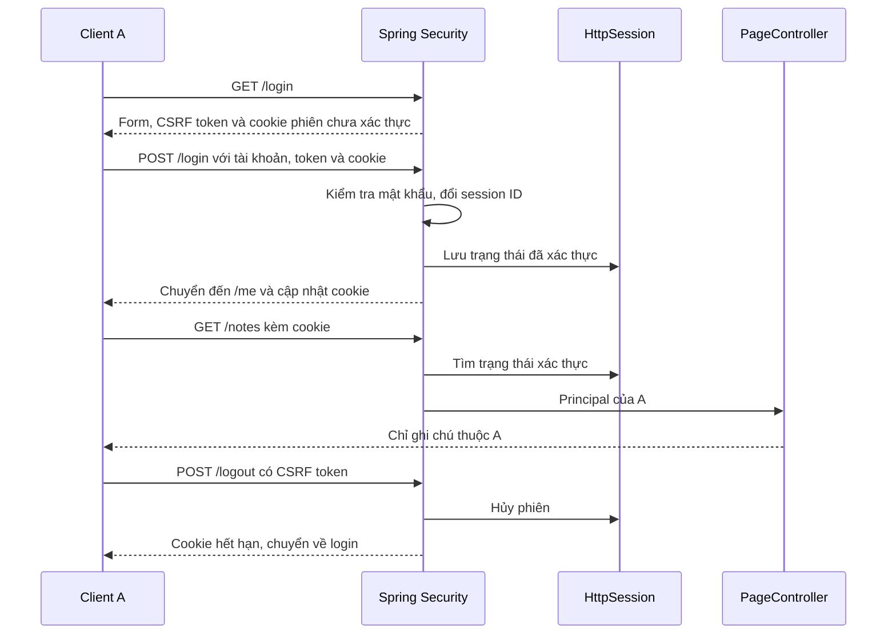
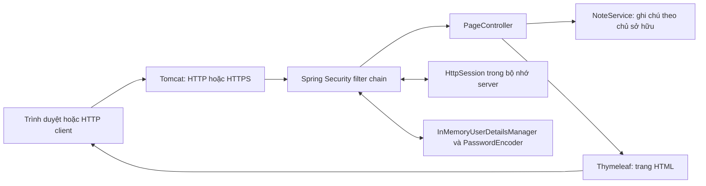
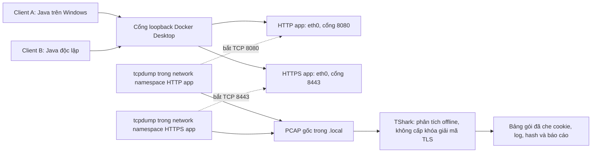

# ATMMT_nhom05

## BÁO CÁO TIỂU LUẬN — AN TOÀN MẠNG MÁY TÍNH

**Đề tài:** Tìm hiểu và mô phỏng Session Hijacking trên ứng dụng Spring Boot, triển khai và đánh giá các biện pháp bảo vệ phiên đăng nhập.<br>
**Nhóm:** 05 — 3 thành viên.<br>
**Cập nhật nội dung:** 14/10/2026.<br>
**Phạm vi:** ứng dụng, tài khoản và dữ liệu giả của nhóm trên loopback/mạng Docker riêng.

| STT | Họ và tên | Mã số sinh viên | Nội dung phụ trách |
|---|---|---|---|
| 1 | Chưa bổ sung | Chưa bổ sung | Ứng dụng Spring Boot, luồng đăng nhập và phân quyền dữ liệu |
| 2 | Chưa bổ sung | Chưa bổ sung | HTTPS, thuộc tính cookie và vòng đời phiên |
| 3 | Chưa bổ sung | Chưa bổ sung | Môi trường lab, bắt gói, mô phỏng và phân tích kết quả |

Tên trường, lớp học phần, giảng viên và thông tin thành viên chưa được cung cấp; nhóm bổ sung theo mẫu nộp bài. Báo cáo này hợp nhất nội dung thiết kế, bảo vệ và thực nghiệm thành một tài liệu chung.

### Tóm tắt

Nhóm xây dựng ứng dụng ghi chú bằng Java/Spring Boot để nghiên cứu phiên đăng nhập dùng cookie. Trên bản HTTP, cookie được trích từ bản bắt gói thật rồi phát lại bằng client độc lập; server nhận diện client này là Alice. Trên bản HTTPS, TShark không giải mã ra header cookie khi không được cấp khóa giải mã. Khi cookie HTTPS còn hiệu lực được giả định đã lộ tại endpoint, client khác vẫn dùng lại được. Logout, timeout không hoạt động và đổi session ID được kiểm chứng riêng để xác định tác dụng và giới hạn của từng biện pháp.

Kết quả hiện có gồm 13 kiểm tra HTTP và 24 kiểm chứng HTTPS của ứng dụng, cùng 9/9 tình huống T01–T09 của thực nghiệm đường truyền. Ba nhóm kết quả có phạm vi khác nhau. Bằng chứng công khai đã che cookie; PCAP gốc và dữ liệu phiên được giữ riêng. Thực nghiệm dùng Java clients và TShark, chưa có ảnh DevTools hoặc video quay trực tiếp quá trình bắt gói.

### Mục lục

1. [Giới thiệu, mục tiêu và phạm vi](#gioi-thieu)
2. [Cơ sở về cookie, session và Session Hijacking](#co-so)
3. [Thiết kế và triển khai ứng dụng](#thiet-ke)
4. [Các biện pháp bảo vệ phiên](#bao-ve)
5. [Môi trường thực nghiệm và vị trí bắt gói](#moi-truong)
6. [Kịch bản thực nghiệm](#kich-ban)
7. [Kết quả kiểm chứng và bằng chứng](#ket-qua)
8. [Phân tích và giới hạn](#phan-tich)
9. [Kết luận và hướng phát triển](#ket-luan)
10. [Tài liệu tham khảo](#tham-khao)

- [Phụ lục A — Hướng dẫn chạy lại và quản lý bằng chứng](#phu-luc-a)
- [Phụ lục B — Đọc PCAP bằng Wireshark/TShark](#phu-luc-b)
- [Phụ lục C — Câu hỏi chuẩn bị bảo vệ](#phu-luc-c)
- [Phụ lục D — Kịch bản trình bày và checklist nộp bài](#phu-luc-d)

<a id="gioi-thieu"></a>

## 1. Giới thiệu, mục tiêu và phạm vi

Nhóm xây dựng ứng dụng ghi chú để quan sát danh tính mà server nhận diện qua session. Tài khoản `alice` và `bob` có dữ liệu riêng, giúp kết quả giả danh thể hiện trực tiếp trên `/me` và `/notes`. Các tài khoản và mật khẩu đều là dữ liệu thực hành công khai.

Đối tượng cần bảo vệ là phiên đã xác thực và quyền đọc ghi chú. Nhóm khảo sát hai tình huống: B nhận cookie được trích từ bản bắt gói HTTP thật và B nhận cookie HTTPS được giả định đã lộ tại endpoint. Khi B được server nhận diện là A, thí nghiệm chứng minh tác động của việc lộ cookie. Thao tác sao chép qua DevTools hoặc công cụ kiểm chứng không tự chứng minh phương thức đánh cắp cookie.

Hai server chỉ publish cổng trên `127.0.0.1`. Bản HTTP phục vụ so sánh với HTTPS trong môi trường của nhóm. Phạm vi chưa bao gồm khai thác hệ thống khác, database, dữ liệu thật hoặc triển khai Internet.

<a id="co-so"></a>

## 2. Cơ sở về cookie, session và Session Hijacking

### 2.1. Cookie, session và luồng xác thực

Cookie mang mã định danh phiên, còn trạng thái xác thực nằm phía server. Khi nhận request, server dùng mã phiên để khôi phục ngữ cảnh bảo mật. Vì vậy, một client có cookie hợp lệ có thể được nhận diện như chủ phiên mà không nhập lại mật khẩu trong mỗi request. Cơ chế phiên và vòng đời của nó cần được bảo vệ đồng thời với đăng nhập. [OWASP Session Management](https://cheatsheetseries.owasp.org/cheatsheets/Session_Management_Cheat_Sheet.html).

Ứng dụng dùng form login sẵn có: `UserDetailsService` cung cấp người dùng, `PasswordEncoder` kiểm tra mật khẩu; sau khi xác thực thành công, người dùng được chuyển đến `/me`. Nhóm giữ cơ chế lưu trạng thái và chống fixation của framework. [Spring Security — Form Login](https://docs.spring.io/spring-security/reference/servlet/authentication/passwords/form.html).



### 2.2. Session Hijacking và Session Fixation

Trong phạm vi báo cáo, Session Hijacking được mô phỏng bằng việc client B sử dụng mã phiên đã xác thực của A còn hiệu lực. Nhóm phân biệt hai tình huống: cookie được quan sát từ request HTTP thật và cookie HTTPS được giả định đã lộ tại endpoint. Tình huống thứ hai minh họa tác động khi có cookie, không chứng minh cookie bị lấy từ lưu lượng TLS.

Session Fixation liên quan mã phiên đã biết trước khi người dùng đăng nhập. Việc đổi ID tại thời điểm login bảo vệ khâu này; nếu cookie mới sau login bị lộ, đổi ID trước đó không tự làm cookie mới mất hiệu lực. Các kiểm chứng trong báo cáo đánh giá riêng việc đổi ID và việc phát lại cookie đã xác thực.

<a id="thiet-ke"></a>

## 3. Thiết kế và triển khai ứng dụng

### 3.1. Kiến trúc và trách nhiệm các thành phần

Ứng dụng dùng Java 17 và Spring Boot 4.1.1. Spring MVC trả các trang Thymeleaf; CSS và JavaScript được phục vụ cục bộ. Spring Security xử lý form login, phân quyền, CSRF và logout. Tài khoản, ghi chú và session được lưu trong bộ nhớ; khởi động lại tiến trình làm mất các session đang hoạt động.



Các trách nhiệm trong mã nguồn:

| Thành phần | Trách nhiệm |
|---|---|
| `SecurityConfig` | Tài khoản lab, encoder, quy tắc truy cập, form login, logout và tên cookie cần xóa |
| `PageController` | Render trang chủ, login, tài khoản và ghi chú; lấy username từ principal |
| `NoteService` | Trả ghi chú của username đã xác thực; dữ liệu mẫu tập trung tại một nơi |
| `Note` | Record biểu diễn tiêu đề và nội dung ghi chú |
| Template và tài nguyên tĩnh | Hiển thị dữ liệu, gửi form có CSRF token, tìm kiếm cục bộ trên ghi chú đã render |

Nguồn: [SecurityConfig](../src/main/java/vn/edu/atmmt/sessionlab/config/SecurityConfig.java), [PageController](../src/main/java/vn/edu/atmmt/sessionlab/web/PageController.java), [NoteService](../src/main/java/vn/edu/atmmt/sessionlab/notes/NoteService.java).

### 3.2. Hợp đồng các đường dẫn

| Phương thức | Đường dẫn | Chức năng và điều kiện |
|---|---|---|
| GET | `/` | Trang giới thiệu công khai |
| GET | `/login` | Form đăng nhập công khai, có hidden CSRF token |
| POST | `/login` | Spring Security xác thực; cần CSRF token hợp lệ |
| GET | `/me` | Danh tính được server xác thực; chưa đăng nhập thì chuyển đến login |
| GET | `/notes` | Ghi chú theo principal, không theo tham số tùy ý từ client |
| POST | `/logout` | Kết thúc phiên; cần CSRF token hợp lệ |

Trang `/me` chỉ hiển thị username, không hiển thị session ID. Ghi chú dùng `th:text` để hiển thị nội dung dạng văn bản. Tìm kiếm JavaScript chỉ lọc các ghi chú server đã cấp cho tài khoản hiện tại; nó không thực hiện phân quyền thay server.

### 3.3. Kiểm soát quyền đọc dữ liệu

`PageController.notes` lấy username bằng `principal.getName()` rồi gọi `NoteService.findByOwner(username)`. Tham số `?username=bob` không tham gia chọn dữ liệu. Trong kiểm chứng, Alice vẫn chỉ nhận ghi chú của Alice khi thêm tham số này.

Ghi chú hiện chỉ đọc. Phạm vi nhỏ này đủ tạo dữ liệu riêng để quan sát danh tính và tác động của việc dùng lại phiên. Không có các endpoint tạo, sửa hoặc xóa ghi chú.

<a id="bao-ve"></a>

## 4. Các biện pháp bảo vệ phiên

### 4.1. Hai cấu hình độc lập

`http-lab` là profile mặc định. Profile `https` bật TLS trực tiếp trên Tomcat, đọc keystore PKCS12 được tạo riêng tại mỗi máy. Không thêm connector HTTP vào tiến trình HTTPS.

| Thuộc tính | Bản HTTP | Bản HTTPS |
|---|---|---|
| URL mặc định | `http://127.0.0.1:8080` | `https://127.0.0.1:8443` |
| Tên cookie | `JSESSIONID` | `__Host-LABSESSION_HTTPS` |
| Secure | Không | Có |
| HttpOnly / SameSite | Có / Lax | Có / Lax |
| Path / Domain | `/` / không khai báo | `/` / không khai báo |
| Timeout không hoạt động | 20 phút | 1 phút để demo |
| Session | Trong tiến trình HTTP | Trong tiến trình HTTPS riêng |

Cookie không được cô lập theo số cổng. Nhóm dùng tên cookie và tiến trình riêng để tránh nhận nhầm phiên khi so sánh hai bản trên cùng máy. Kiểm chứng đã xác nhận việc gửi mã phiên HTTPS dưới tên `JSESSIONID` không xác thực được bản HTTPS.

Nguồn cấu hình: [application.properties](../src/main/resources/application.properties), [HTTP](../src/main/resources/application-http-lab.properties), [HTTPS](../src/main/resources/application-https.properties), [Compose HTTPS](../compose.https.yaml).

### 4.2. Chứng chỉ và cách chạy TLS

Script `New-LabCertificate.ps1` tạo cặp khóa RSA 3072 bit, chứng chỉ SHA-256 có SAN cho `localhost` và `127.0.0.1`, hạn 30 ngày. Khóa riêng nằm trong `.local/tls/localhost.p12`; mật khẩu ngẫu nhiên nằm trong `runtime.env` cùng thư mục. Các file này bị loại khỏi Git và Docker build context. Container chỉ mount keystore read-only khi chạy.

Công cụ `VerifyHttpsLab.java` nạp chứng chỉ công khai được chỉ định vào kho tin cậy riêng của lần chạy. Nó giữ kiểm tra chứng chỉ và hostname, không dùng trust-all. Khi demo bằng trình duyệt, nhóm cần chủ động tin cậy đúng chứng chỉ theo README; không coi việc bỏ qua cảnh báo TLS là cách cấu hình hoàn chỉnh.

Các lựa chọn trên phục vụ lab. Mật khẩu qua biến môi trường vẫn có thể được người quản trị Docker đọc; tag image cũng có thể nhận bản vá. Không dùng mô hình này như cam kết đã đáp ứng mọi yêu cầu vận hành production.

### 4.3. Ý nghĩa các biện pháp

| Biện pháp | Tác dụng | Giới hạn |
|---|---|---|
| HTTPS | Bảo vệ dữ liệu khi truyền giữa client và server có xác minh chứng chỉ | Không vô hiệu cookie đã lộ từ nguồn khác |
| Secure | Yêu cầu cookie được gửi qua kênh bảo mật theo quy tắc trình duyệt | Localhost có xử lý đặc biệt; client tự đặt header không chứng minh chính sách trình duyệt |
| HttpOnly | Hạn chế JavaScript đọc cookie trực tiếp | Không chặn mọi hành động do XSS trong phiên |
| SameSite=Lax | Hạn chế cookie trên một số request khác site | Không thay hoàn toàn CSRF token |
| Tiền tố `__Host-` | Ràng buộc Secure, Path `/`, không có Domain ở trình duyệt hỗ trợ | Không tạo cơ chế chống dùng lại cookie |

Ý nghĩa thuộc tính và tiền tố cookie được đối chiếu với [MDN — Set-Cookie](https://developer.mozilla.org/en-US/docs/Web/HTTP/Reference/Headers/Set-Cookie). Việc quan sát header chỉ xác nhận server phát thuộc tính; phép thử trình duyệt khác site cần bằng chứng riêng.

### 4.4. Đổi ID, logout và timeout

Spring Security giữ bảo vệ Session Fixation mặc định: ID phiên thay đổi khi đăng nhập thành công. Công cụ kiểm chứng so sánh ID trong bộ nhớ, không in ra log, rồi xác nhận ID cũ không có quyền của Alice. [Spring Security — Session Management](https://docs.spring.io/spring-security/reference/servlet/authentication/session-management.html).

Logout hợp lệ là POST có CSRF token. `SecurityConfig` hủy session, xóa authentication và yêu cầu xóa cookie theo đúng tên của profile. Trong kết quả thực tế, server dùng ngày `Expires` trong quá khứ để xóa cookie, đồng thời giữ `Path=/; Secure` ở HTTPS. Cả client gốc và client cầm bản sao cookie đều phải đăng nhập lại sau logout.

Timeout HTTPS 1 phút là giới hạn không hoạt động. Phép thử tạo phiên Bob, giữ bản sao cookie, ngừng request từ cả hai client trong 75 giây rồi truy cập `/me`. Cả hai bị chuyển đến login. Đây không phải giới hạn tuổi thọ tuyệt đối: client vẫn tạo hoạt động có thể duy trì phiên.

CSRF được giữ ở login và logout. Các request thiếu token bị từ chối trong cả kiểm tra HTTP và HTTPS. Cơ chế này không được trình bày như cách ngăn người đã có đủ phiên và token dùng lại phiên.

<a id="moi-truong"></a>

## 5. Môi trường thực nghiệm và vị trí bắt gói



Việc publish port vẫn chỉ ở loopback Windows. Điểm quan sát thực tế là interface `eth0` bên trong network namespace của từng container ứng dụng, sau cơ chế chuyển tiếp cổng của Docker Desktop. Đây là bắt gói trên mạng Docker riêng; không phải bắt gói bằng Npcap trên Windows loopback, ARP spoofing hay quan sát LAN của người khác.

Bản HTTPS xử lý TLS tại Tomcat, nên lưu lượng ở điểm bắt gói này vẫn là TLS trước khi ứng dụng giải mã. Công cụ phân tích không được mount keystore và không được cấp TLS key log.

Image công cụ được build từ Debian Bookworm, cài tcpdump, TShark và FFmpeg từ kho Debian. TShark trong lần thực nghiệm là Wireshark 4.0.17. Container capture chỉ được gắn vào network namespace của app, mount thư mục của chính lần chạy và nhận các capability cần cho tcpdump: `NET_RAW`, `SETUID`, `SETGID`, `CHOWN`. Không dùng `--privileged` hoặc mạng host. Container phân tích offline dùng `--network none`.

<a id="kich-ban"></a>

## 6. Kịch bản thực nghiệm

Phần thực nghiệm kiểm tra chuỗi: một request HTTP mang cookie phiên được bắt trên mạng của ứng dụng → cookie được lấy từ bản bắt gói → client B dùng lại cookie đó → server nhận diện B là Alice. Sau đó nhóm đối chiếu với HTTPS và kiểm tra logout, timeout, đổi session ID.

Client A và B là các HTTP client Java có kho cookie độc lập. B không nhập mật khẩu trong bước phát lại. Tài khoản Alice/Bob là tài khoản thực hành công khai; chỉ dùng server tại `127.0.0.1:8080` và `127.0.0.1:8443`.

### 6.1. HTTP: cookie từ bản bắt gói thật

1. B truy cập `/me` khi chưa có phiên; server chuyển về login.
2. A đăng nhập Alice. Chương trình đối chiếu session ID trước/sau login bằng fingerprint SHA-256 rút gọn.
3. A gửi `/me` và `/notes` với marker riêng của lần chạy trong query string. tcpdump ghi gói thật vào `http-seed.pcap`.
4. TShark đọc `http.cookie` ở request đúng marker. Giá trị cookie chỉ được lưu vào `captured-http-cookie.txt` dưới `.local/`.
5. Một client B độc lập gửi đúng cookie đã lấy từ file trích xuất. `/me` trả danh tính Alice. Các request này được ghi riêng vào `http-replay.pcap`.
6. A logout hợp lệ; B giữ cookie cũ bị chuyển về login. Hai bản HTTP được ghép thành `http.pcap` để thuận tiện xem toàn bộ luồng.

Chương trình kiểm tra cookie trích từ gói khớp phiên A trước khi phát lại, nhưng nguồn cookie của B là file do TShark tạo. Nếu không tìm được cookie trong PCAP, chương trình dừng và không công bố kết quả hoàn tất. Marker giúp chọn request của chính lần thực nghiệm, tránh nhận nhầm request khác.

### 6.2. HTTPS và giới hạn phòng vệ

1. Bản bắt gói mới `https.pcap` được mở trước khi client Java tạo kết nối TLS.
2. Client xác minh đúng chứng chỉ và hostname, đăng nhập Alice, kiểm tra thuộc tính cookie trong phản hồi tại endpoint.
3. B dùng bản sao cookie HTTPS còn hiệu lực đã biết tại client để minh họa giả định cookie bị lộ. B được nhận diện là Alice.
4. A logout; cả client gốc và B dùng cookie cũ mất quyền.
5. Tạo phiên Bob mới; cả client gốc và client giữ bản sao ngừng request 75 giây. Truy cập lại phải đăng nhập.
6. TShark xác nhận có frame TLS và bản ghi ngoài loại 23, nhưng không giải mã được header cookie. Với TLS 1.3, loại ngoài 23 có thể chứa handshake đã mã hóa; không suy ra nội dung bên trong hoặc số request HTTP. Công cụ cũng kiểm tra chuỗi cookie HTTPS đã biết không xuất hiện trong byte PCAP.

Cookie HTTPS ở bước 3 lấy từ phía client trong mô phỏng, **không được trích từ PCAP TLS**. Các thuộc tính `Secure`, `HttpOnly`, `SameSite` được quan sát qua HTTP client đã xác minh TLS; đây không phải ảnh DevTools hoặc phép thử mọi quy tắc trình duyệt.

<a id="ket-qua"></a>

## 7. Kết quả kiểm chứng và bằng chứng

### 7.1. Kiểm chứng ứng dụng và bản bảo vệ

Kết quả ngày 13/10/2026 đã ghi trong [README ứng dụng](../README.md#kết-quả-phần-2-ngày-13102026): 13 kiểm tra HTTP và 24 kiểm chứng HTTPS đạt. Các nhóm hành vi gồm phân quyền dữ liệu, CSRF, đổi ID, cookie sao chép, logout, timeout và xác minh TLS.

Bản bàn giao được kiểm tra lại từ mã nguồn chỉ chứa file trong Git, tạo chứng chỉ mới thay vì sao chép `.local/` của máy phát triển. [Hướng dẫn bàn giao](BAN_GIAO_NHOM05.md) ghi cách tái hiện và kết quả cụ thể của lần kiểm tra này. Phép thử trên cùng máy với checkout sạch không thay cho xác nhận thành viên khác đã chạy thành công trên máy riêng.

Kết quả trọng tâm là: cookie HTTPS còn hiệu lực đã sao chép vẫn xác thực được; sau logout hoặc timeout, cookie đó mất quyền. Hai quan sát này giúp đánh giá đúng tác dụng và giới hạn của các biện pháp đã triển khai.

### 7.2. Kết quả thực nghiệm đường truyền

Lần chạy **`run-063d980c01c2`**, bắt đầu 16:41 ngày 14/10/2026 (UTC+7), đạt **9/9 tình huống T01–T09**. Ứng dụng chạy từ commit `11e1ce5973b37b551ce335b511bcc6c0c41f9ca3`; các script thực nghiệm nằm tại `scripts/part3/` trong repository.

| Mã | Quan sát thực tế | Kết quả |
|---|---|---|
| T01 | B chưa có phiên truy cập `/me` → 302 về login | Đạt |
| T02 | B dùng cookie trích từ PCAP HTTP → server nhận diện Alice | Đạt |
| T03 | Đọc được cookie tại frame 22 của `http-seed.pcap`, đúng marker của lần chạy | Đạt |
| T04 | TLS 1.3 có 83 frame chứa bản ghi TLS, 59 frame chứa loại ngoài 23; 0 header cookie được giải mã; chuỗi cookie đã biết không có trong byte PCAP | Đạt |
| T05 | Cookie HTTPS có Secure, HttpOnly, SameSite=Lax, Path=/, không Domain | Đạt bằng client xác minh TLS |
| T06 | B dùng cookie HTTPS giả định đã lộ tại endpoint → danh tính Alice | Đạt; không lấy cookie từ TLS PCAP |
| T07 | Sau A logout, cả A và B giữ cookie cũ đều về login | Đạt |
| T08 | Sau 75.029 giây không request, cả hai client giữ phiên Bob về login | Đạt |
| T09 | Fingerprint ID trước/sau login khác nhau ở HTTP và HTTPS | Đạt |

Bản HTTP ghép có 70 gói, gồm 10 request được giải mã. HTTPS có 200 gói được capture. tcpdump báo **0 gói bị kernel drop** trong cả ba giai đoạn; số received/captured được giữ riêng trong thống kê, không suy ra đã ghi mọi gói có thể quan sát.

**Bộ bằng chứng công khai, đã che cookie:**

- [Báo cáo HTML có bảng gói và video](minh-chung/phan3/run-063d980c01c2/index.html) — tải repository về để mở; GitHub không hiển thị HTML như một website.
- [Log tình huống và thời gian](minh-chung/phan3/run-063d980c01c2/events.tsv), [bảng gói đã che](minh-chung/phan3/run-063d980c01c2/packets-redacted.tsv), [fingerprint phiên](minh-chung/phan3/run-063d980c01c2/session-fingerprints.tsv).
- [Thống kê capture](minh-chung/phan3/run-063d980c01c2/capture-statistics.txt), [SHA-256 PCAP](minh-chung/phan3/run-063d980c01c2/capture-manifest.json), [dấu hoàn tất](minh-chung/phan3/run-063d980c01c2/COMPLETE.txt).
- Ảnh trình bày [HTTP](minh-chung/phan3/run-063d980c01c2/frame-01.jpg), [HTTPS](minh-chung/phan3/run-063d980c01c2/frame-02.jpg), [vòng đời phiên](minh-chung/phan3/run-063d980c01c2/frame-03.jpg).
- [Video dự phòng 24 giây, không âm thanh](minh-chung/phan3/run-063d980c01c2/demo-ket-qua.mp4): trình bày lại kết quả đã ghi, **không phải quay trực tiếp quá trình bắt gói**.

PCAP gốc nằm tại `.local/part3/run-063d980c01c2/`, được liên kết bằng hash trong manifest. Phân tích dùng TShark, không dùng Wireshark GUI. Chưa có ảnh DevTools; nếu giảng viên yêu cầu riêng bằng chứng trình duyệt hoặc quay thao tác trực tiếp, nhóm cần thực hiện bổ sung theo [hướng dẫn bàn giao](BAN_GIAO_NHOM05.md).

<a id="phan-tich"></a>

## 8. Phân tích và giới hạn

Kết quả cần được đọc theo từng khâu. Cookie đọc được trên request HTTP là bằng chứng đường lộ trong môi trường đã chọn. B dùng cookie đó rồi được nhận diện là Alice là bằng chứng tác động. TLS bảo vệ dữ liệu đang truyền, nhưng không tự vô hiệu cookie còn sống mà client khác đã có từ một nguồn khác.

Logout phải hủy trạng thái phía server; chỉ xóa bản cookie của A là chưa đủ. Timeout trong ứng dụng là timeout không hoạt động, không phải tuổi thọ tuyệt đối. Đổi ID ở login bảo vệ tình huống fixation; không làm cookie mới bị lộ trở nên vô dụng.

Thí nghiệm này dùng một máy Windows, Docker và Java clients. Không suy ra kết quả sniffing trong LAN, hành vi mọi trình duyệt, chống XSS hoặc chống CSRF đầy đủ chỉ từ PCAP và các thuộc tính cookie. Không có khóa giải mã TLS được cung cấp trong phép đối chiếu.

<a id="ket-luan"></a>

## 9. Kết luận và hướng phát triển

Nhóm đã xây dựng ứng dụng có danh tính xác thực, dữ liệu theo chủ sở hữu và vòng đời phiên có thể quan sát. Thực nghiệm nối được bằng chứng đường truyền với hành vi ứng dụng: cookie đọc được từ request HTTP được client độc lập dùng lại thành công. Đối chiếu HTTPS cho thấy dữ liệu cookie không đọc được từ PCAP trong điều kiện không cấp khóa giải mã.

HTTPS và thuộc tính cookie bảo vệ những khâu cụ thể; chúng không tự vô hiệu một cookie còn sống đã bị lộ từ nguồn khác. Logout hủy phiên phía server và timeout không hoạt động làm bản sao cookie mất quyền trong các phép thử. Đổi session ID khi login hỗ trợ chống fixation nhưng không thay thế việc bảo vệ cookie sau đăng nhập.

Kết quả đáp ứng phạm vi mô phỏng của lab, không phải chứng nhận an toàn cho một hệ thống production. Các bước tiếp theo có thể gồm xác nhận tái hiện trên máy thành viên khác, bổ sung quan sát DevTools, kiểm tra hành vi cookie khác site trên trình duyệt và quay thao tác trực tiếp nếu giảng viên yêu cầu. Những nội dung này chưa được ghi nhận là đã thực hiện.

<a id="tham-khao"></a>

## 10. Tài liệu tham khảo

Các nguồn dưới đây được dẫn tại nội dung liên quan; phiên bản cấu hình và kết quả thực nghiệm được đối chiếu với mã nguồn và bằng chứng của repository.

- [OWASP Session Management](https://cheatsheetseries.owasp.org/cheatsheets/Session_Management_Cheat_Sheet.html)
- [Spring Security — Form Login](https://docs.spring.io/spring-security/reference/servlet/authentication/passwords/form.html)
- [MDN — Set-Cookie](https://developer.mozilla.org/en-US/docs/Web/HTTP/Reference/Headers/Set-Cookie)
- [Spring Security — Session Management](https://docs.spring.io/spring-security/reference/servlet/authentication/session-management.html)
- [TShark manual](https://www.wireshark.org/docs/man-pages/tshark.html)
- [HTTP fields](https://www.wireshark.org/docs/dfref/h/http.html)
- [TLS fields](https://www.wireshark.org/docs/dfref/t/tls.html)

<a id="phu-luc-a"></a>

## Phụ lục A — Hướng dẫn chạy lại và quản lý bằng chứng

### A.1. Chạy ứng dụng HTTP

Máy cần Docker Desktop đang chạy với Linux containers và Docker Compose. Các lệnh trong phụ lục được chạy tại thư mục `session-hijacking-lab` của repository:

```powershell
docker compose up --build -d
```

Mở `http://127.0.0.1:8080`. Tài khoản thực hành công khai: `alice` / `AliceLab!2026`, `bob` / `BobLab!2026`. Không dùng các mật khẩu này cho tài khoản thật.

### A.2. Chạy ứng dụng HTTPS

Cần JDK 17 trở lên để tạo chứng chỉ và chạy client kiểm chứng. Chỉ tạo chứng chỉ khi máy chưa có bộ chứng chỉ lab; không ghi đè bộ đang dùng:

```powershell
# Chỉ chạy bước này khi chưa có bộ chứng chỉ trong .local/tls/:
.\scripts\New-LabCertificate.ps1
docker compose -f compose.https.yaml up --build -d
java scripts/VerifyHttpsLab.java .local/tls/localhost.cer
```

Mở `https://127.0.0.1:8443`. Khi dùng trình duyệt, tin cậy đúng chứng chỉ theo [README ứng dụng](../README.md); client Java dùng kho tin cậy riêng với chứng chỉ chỉ định. Mỗi máy tự tạo bộ chứng chỉ của mình, không nhận khóa riêng hoặc mật khẩu keystore qua Git.

### A.3. Chạy thực nghiệm đường truyền và tạo báo cáo HTML

Điều kiện: Docker Desktop với Linux containers, Java/JDK 17 trở lên, bộ chứng chỉ HTTPS riêng của máy đã tạo theo README. Dùng host port mặc định 8080/8443 cho script này.

Mở **PowerShell** tại thư mục `session-hijacking-lab`:

```powershell
docker build -t session-lab-packet-tools:local scripts/part3/packet-tools
.\scripts\part3\Run-Part3.ps1
```

Chờ phép thử timeout 75 giây. Script chỉ công bố thư mục dưới `docs/minh-chung/phan3/` khi tất cả tình huống bắt buộc đạt; kết quả dở dang nằm trong `.local/` để chẩn đoán.

Mỗi lần chạy tạo thư mục `run-...` riêng:

| Vị trí | Nội dung | Đưa lên Git? |
|---|---|---|
| `.local/part3/run-.../` | PCAP gốc, cookie trích xuất, state và dữ liệu phân tích có giá trị phiên | Không |
| `docs/minh-chung/phan3/run-.../events.tsv` | Tình huống, thời gian, kết quả thực tế và nguồn bằng chứng | Có, sau rà soát |
| `packets-redacted.tsv` | Frame, stream, method/URI, cookie đã che, loại TLS record | Có |
| `session-fingerprints.tsv` | Hash rút gọn trước/sau login, không phải session ID đầy đủ | Có |
| `capture-manifest.json` | Tên PCAP, kích thước, SHA-256 để đối chiếu bản gốc | Có |
| `capture-statistics.txt` | Số gói và số gói bị kernel drop của từng lần capture | Có |
| `COMPLETE.txt` | Chỉ được tạo sau khi mọi điều kiện kiểm chứng đạt | Có |

Để tạo báo cáo HTML từ một lần đã hoàn tất, thay `run-...` bằng tên thực tế được script in ra:

```powershell
python scripts/part3/Build-Part3Report.py docs/minh-chung/phan3/run-...
```

HTML dùng CSS cục bộ và số liệu của lần chạy đó. Các trang `slide-*.html` phục vụ trình bày kết quả; nếu ghép thành video, đó là video tái trình bày bằng chứng đã ghi, không phải video quay trực tiếp lúc thực nghiệm.

<a id="phu-luc-b"></a>

## Phụ lục B — Đọc PCAP bằng Wireshark/TShark

PCAP giữ riêng trên máy. Nếu dùng Wireshark GUI, mở file bằng **File → Open** rồi xem các trường dưới **Hypertext Transfer Protocol** hoặc **Transport Layer Security**. Không đưa ảnh có giá trị cookie hoặc token đầy đủ vào slide.

| Mục đích | Display filter |
|---|---|
| Request HTTP có cookie | `http.request && http.cookie` |
| Bước tạo request của A | `http.request.uri contains "stage=seed"` |
| Bước phát lại của B | `http.request.uri contains "stage=replay"` |
| Lưu lượng TLS | `tls` |
| Bản ghi ngoài loại 23, gồm TLS 1.3 chưa giải mã | `tls.record.content_type == 23 || tls.record.opaque_type == 23` |

Các cổng không chuẩn có thể cần **Decode As** TCP 8080 → HTTP, TCP 8443 → TLS. Script TShark đã truyền `-d` tương ứng. Capture filter (`tcp port ...`) khác display filter (`http...`, `tls...`); nhóm cần phân biệt khi trả lời câu hỏi.

Ở TShark 4.0.17 của lần chạy này, TLS 1.3 chưa giải mã dùng trường `tls.record.opaque_type` cho loại ngoài. Không được chỉ lọc `tls.record.content_type == 23` rồi kết luận không có lưu lượng mã hóa.

TShark là công cụ dòng lệnh của Wireshark; `-r` đọc PCAP, `-Y` lọc hiển thị, `-e` chọn trường và `-T json` xuất dữ liệu có cấu trúc. Xem [TShark manual](https://www.wireshark.org/docs/man-pages/tshark.html), [HTTP fields](https://www.wireshark.org/docs/dfref/h/http.html) và [TLS fields](https://www.wireshark.org/docs/dfref/t/tls.html).

<a id="phu-luc-c"></a>

## Phụ lục C — Câu hỏi chuẩn bị bảo vệ

1. **Cookie chứa gì?** Mã định danh để server tìm phiên; trạng thái xác thực được giữ phía server.
2. **Vì sao B không nhập mật khẩu vẫn là Alice?** Trong thí nghiệm, B gửi đúng cookie của phiên Alice còn hiệu lực.
3. **Vì sao HTTPS vẫn cho dùng lại cookie đã sao chép?** TLS bảo vệ kênh truyền; server vẫn nhận cookie hợp lệ của phiên đó.
4. **Vì sao cần hủy session khi logout?** Chỉ xóa bản cookie ở A không làm bản sao tại B mất hiệu lực phía server.
5. **Fixation khác dùng lại cookie sau login thế nào?** Fixation liên quan ID đã biết trước lúc đăng nhập; thí nghiệm sao chép dùng ID của phiên đã xác thực.
6. **Timeout 1 phút có đảm bảo phiên chỉ sống 1 phút không?** Không; đó là khoảng không hoạt động, không phải tuổi thọ tuyệt đối.
7. **Vì sao thử bằng hai tab chưa đủ tạo hai danh tính?** Hai tab cùng browser profile thường dùng chung cookie.
8. **Bằng chứng client và bằng chứng mạng khác nhau thế nào?** HTTP client xác nhận hành vi ứng dụng; bản bắt gói xác nhận dữ liệu quan sát được trên đường truyền ở môi trường đã chọn.

<a id="phu-luc-d"></a>

## Phụ lục D — Kịch bản trình bày và checklist nộp bài

### D.1. Kịch bản trình bày khoảng 4–5 phút

1. **30 giây — Mô hình:** mở sơ đồ ở mục 5; chỉ rõ client A/B độc lập, cổng loopback và điểm bắt `eth0` trong Docker.
2. **60 giây — HTTP:** mở báo cáo HTML, giải thích T01 → T03 → T02. Chỉ request frame 22 (cookie đã che), request của B có `stage=replay` và log server nhận diện Alice. B không đăng nhập bằng mật khẩu.
3. **60 giây — HTTPS:** đối chiếu TLS 1.3 với HTTP. Nêu không cấp khóa giải mã; loại ngoài 23 không xác định nội dung bên trong. Giải thích T06 dùng cookie biết tại endpoint và khác với cookie lấy từ mạng ở T02.
4. **60 giây — Vòng đời:** trình bày T07, T08, T09 và fingerprint. Logout hủy phiên phía server; timeout tính theo khoảng không hoạt động; đổi ID không ngăn cookie mới bị lộ.
5. **30 giây — Giới hạn:** một máy, mạng Docker riêng, Java clients; chưa có ảnh DevTools, không chứng minh khả năng nghe lén LAN hoặc chống mọi XSS/CSRF.

Nếu cần demo trực tiếp, chạy script ở phụ lục A.3; script in tiến độ chờ timeout 15 giây một lần. Mỗi lần chạy dùng phiên và marker mới, lưu bộ bằng chứng riêng. Nếu môi trường gặp lỗi, dùng báo cáo/ảnh/video đã ghi và nói rõ đây là kết quả của lần chạy ngày 14/10. Không trình chiếu file cookie riêng hoặc nội dung POST login trong PCAP.

### D.2. Checklist của cả nhóm trước khi nộp

- Đưa mã kịch bản, hướng dẫn, bảng kết quả đã che và ảnh/video trình bày lên Git.
- Giữ PCAP gốc tại máy để giảng viên/nhóm kiểm tra khi cần; đối chiếu SHA-256 với manifest công khai.
- Chạy lại trên máy thành viên nhận và ghi môi trường thực tế; kiểm tra lại interface, cổng và chứng chỉ khi đổi môi trường.
- Giải thích nguồn cookie ở từng kịch bản, điểm bắt gói, điều kiện timeout và các giới hạn ở mục 8.
- Bổ sung thông tin thành viên ở đầu báo cáo, định dạng theo mẫu của giảng viên, chuẩn bị slide và tập demo.
