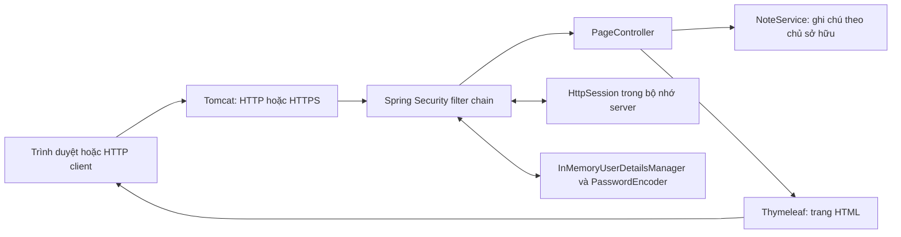
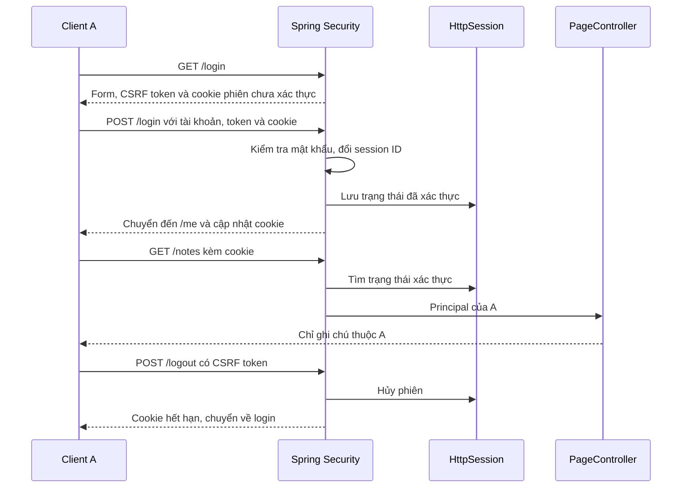

# Thiết kế ứng dụng và bảo vệ phiên đăng nhập

**Đề tài:** Tìm hiểu và mô phỏng Session Hijacking trên ứng dụng Spring Boot, triển khai và đánh giá các biện pháp bảo vệ phiên đăng nhập. 
**Phạm vi tài liệu:** nội dung báo cáo của người 1 và người 2, dựa trên mã nguồn thực tế trong repository. 
**Cập nhật:** 14/10/2026.

Tài liệu này có thể ghép vào báo cáo chung của nhóm. Bìa, thông tin sinh viên và hình thức trình bày cần tuân theo mẫu của giảng viên. Phần bắt gói Wireshark, mô tả đường lộ cookie và video do người 3 bổ sung sau khi thực nghiệm.

## 1. Mục tiêu và mô hình thí nghiệm

Nhóm xây dựng ứng dụng ghi chú để quan sát danh tính mà server nhận diện qua session. Tài khoản `alice` và `bob` có dữ liệu riêng, giúp kết quả giả danh thể hiện trực tiếp trên `/me` và `/notes`. Các tài khoản và mật khẩu đều là dữ liệu thực hành công khai.

Đối tượng cần bảo vệ là phiên đã xác thực và quyền đọc ghi chú. Trong kịch bản dùng lại cookie, client B được giả định đã có cookie còn hiệu lực của A. Nếu B được server nhận diện là A, thí nghiệm chứng minh tác động của việc lộ cookie. Thao tác sao chép qua DevTools hoặc công cụ kiểm chứng không tự chứng minh phương thức đánh cắp cookie.

Hai server chỉ publish cổng trên `127.0.0.1`. Bản HTTP phục vụ so sánh với HTTPS trong môi trường của nhóm. Phạm vi chưa bao gồm khai thác hệ thống khác, database, dữ liệu thật hoặc triển khai Internet.

## 2. Phần người 1 — Thiết kế và triển khai ứng dụng

### 2.1. Kiến trúc

Ứng dụng dùng Java 17 và Spring Boot 4.1.1. Spring MVC trả các trang Thymeleaf; CSS và JavaScript được phục vụ cục bộ. Spring Security xử lý form login, phân quyền, CSRF và logout. Tài khoản, ghi chú và session được lưu trong bộ nhớ; khởi động lại tiến trình làm mất các session đang hoạt động.

Các trách nhiệm trong mã nguồn:

| Thành phần | Trách nhiệm |
|---|---|
| `SecurityConfig` | Tài khoản lab, encoder, quy tắc truy cập, form login, logout và tên cookie cần xóa |
| `PageController` | Render trang chủ, login, tài khoản và ghi chú; lấy username từ principal |
| `NoteService` | Trả ghi chú của username đã xác thực; dữ liệu mẫu tập trung tại một nơi |
| `Note` | Record biểu diễn tiêu đề và nội dung ghi chú |
| Template và tài nguyên tĩnh | Hiển thị dữ liệu, gửi form có CSRF token, tìm kiếm cục bộ trên ghi chú đã render |

Nguồn: [SecurityConfig](../src/main/java/vn/edu/atmmt/sessionlab/config/SecurityConfig.java), [PageController](../src/main/java/vn/edu/atmmt/sessionlab/web/PageController.java), [NoteService](../src/main/java/vn/edu/atmmt/sessionlab/notes/NoteService.java).

### 2.2. Hợp đồng các đường dẫn

| Phương thức | Đường dẫn | Chức năng và điều kiện |
|---|---|---|
| GET | `/` | Trang giới thiệu công khai |
| GET | `/login` | Form đăng nhập công khai, có hidden CSRF token |
| POST | `/login` | Spring Security xác thực; cần CSRF token hợp lệ |
| GET | `/me` | Danh tính được server xác thực; chưa đăng nhập thì chuyển đến login |
| GET | `/notes` | Ghi chú theo principal, không theo tham số tùy ý từ client |
| POST | `/logout` | Kết thúc phiên; cần CSRF token hợp lệ |

Trang `/me` chỉ hiển thị username, không hiển thị session ID. Ghi chú dùng `th:text` để hiển thị nội dung dạng văn bản. Tìm kiếm JavaScript chỉ lọc các ghi chú server đã cấp cho tài khoản hiện tại; nó không thực hiện phân quyền thay server.

### 2.3. Cookie và session trong ứng dụng

Cookie mang mã định danh phiên, còn trạng thái xác thực nằm phía server. Khi nhận request, server dùng mã phiên để khôi phục ngữ cảnh bảo mật. Vì vậy, một client có cookie hợp lệ có thể được nhận diện như chủ phiên mà không nhập lại mật khẩu trong mỗi request. Cơ chế phiên và vòng đời của nó cần được bảo vệ đồng thời với đăng nhập. [OWASP Session Management](https://cheatsheetseries.owasp.org/cheatsheets/Session_Management_Cheat_Sheet.html).

Ứng dụng dùng form login sẵn có: `UserDetailsService` cung cấp người dùng, `PasswordEncoder` kiểm tra mật khẩu; sau khi xác thực thành công, người dùng được chuyển đến `/me`. Nhóm giữ cơ chế lưu trạng thái và chống fixation của framework. [Spring Security — Form Login](https://docs.spring.io/spring-security/reference/servlet/authentication/passwords/form.html).

### 2.4. Kiểm soát quyền đọc dữ liệu

`PageController.notes` lấy username bằng `principal.getName()` rồi gọi `NoteService.findByOwner(username)`. Tham số `?username=bob` không tham gia chọn dữ liệu. Trong kiểm chứng, Alice vẫn chỉ nhận ghi chú của Alice khi thêm tham số này.

Ghi chú hiện chỉ đọc. Phạm vi nhỏ này đủ tạo dữ liệu riêng để quan sát danh tính và tác động của việc dùng lại phiên. Không có các endpoint tạo, sửa hoặc xóa ghi chú.

## 3. Phần người 2 — HTTPS và vòng đời phiên

### 3.1. Hai cấu hình độc lập

`http-lab` là profile mặc định. Profile `https` bật TLS trực tiếp trên Tomcat, đọc keystore PKCS12 được tạo riêng tại mỗi máy. Không thêm connector HTTP vào tiến trình HTTPS.

| Thuộc tính | Bản HTTP | Bản HTTPS |
|---|---|---|
| URL mặc định | `http://127.0.0.1:8080` | `https://127.0.0.1:8443` |
| Tên cookie | `JSESSIONID` | `__Host-LABSESSION_HTTPS` |
| Secure | Không | Có |
| HttpOnly / SameSite | Có / Lax | Có / Lax |
| Path / Domain | `/` / không khai báo | `/` / không khai báo |
| Timeout không hoạt động | 20 phút | 1 phút để demo |
| Session | Trong tiến trình HTTP | Trong tiến trình HTTPS riêng |

Cookie không được cô lập theo số cổng. Nhóm dùng tên cookie và tiến trình riêng để tránh nhận nhầm phiên khi so sánh hai bản trên cùng máy. Kiểm chứng đã xác nhận việc gửi mã phiên HTTPS dưới tên `JSESSIONID` không xác thực được bản HTTPS.

Nguồn cấu hình: [application.properties](../src/main/resources/application.properties), [HTTP](../src/main/resources/application-http-lab.properties), [HTTPS](../src/main/resources/application-https.properties), [Compose HTTPS](../compose.https.yaml).

### 3.2. Chứng chỉ và cách chạy TLS

Script `New-LabCertificate.ps1` tạo cặp khóa RSA 3072 bit, chứng chỉ SHA-256 có SAN cho `localhost` và `127.0.0.1`, hạn 30 ngày. Khóa riêng nằm trong `.local/tls/localhost.p12`; mật khẩu ngẫu nhiên nằm trong `runtime.env` cùng thư mục. Các file này bị loại khỏi Git và Docker build context. Container chỉ mount keystore read-only khi chạy.

Công cụ `VerifyHttpsLab.java` nạp chứng chỉ công khai được chỉ định vào kho tin cậy riêng của lần chạy. Nó giữ kiểm tra chứng chỉ và hostname, không dùng trust-all. Khi demo bằng trình duyệt, nhóm cần chủ động tin cậy đúng chứng chỉ theo README; không coi việc bỏ qua cảnh báo TLS là cách cấu hình hoàn chỉnh.

Các lựa chọn trên phục vụ lab. Mật khẩu qua biến môi trường vẫn có thể được người quản trị Docker đọc; tag image cũng có thể nhận bản vá. Không dùng mô hình này như cam kết đã đáp ứng mọi yêu cầu vận hành production.

### 3.3. Ý nghĩa các biện pháp

| Biện pháp | Tác dụng | Giới hạn |
|---|---|---|
| HTTPS | Bảo vệ dữ liệu khi truyền giữa client và server có xác minh chứng chỉ | Không vô hiệu cookie đã lộ từ nguồn khác |
| Secure | Yêu cầu cookie được gửi qua kênh bảo mật theo quy tắc trình duyệt | Localhost có xử lý đặc biệt; client tự đặt header không chứng minh chính sách trình duyệt |
| HttpOnly | Hạn chế JavaScript đọc cookie trực tiếp | Không chặn mọi hành động do XSS trong phiên |
| SameSite=Lax | Hạn chế cookie trên một số request khác site | Không thay hoàn toàn CSRF token |
| Tiền tố `__Host-` | Ràng buộc Secure, Path `/`, không có Domain ở trình duyệt hỗ trợ | Không tạo cơ chế chống dùng lại cookie |

Ý nghĩa thuộc tính và tiền tố cookie được đối chiếu với [MDN — Set-Cookie](https://developer.mozilla.org/en-US/docs/Web/HTTP/Reference/Headers/Set-Cookie). Việc quan sát header chỉ xác nhận server phát thuộc tính; phép thử trình duyệt khác site cần bằng chứng riêng.

### 3.4. Đổi ID, logout và timeout

Spring Security giữ bảo vệ Session Fixation mặc định: ID phiên thay đổi khi đăng nhập thành công. Công cụ kiểm chứng so sánh ID trong bộ nhớ, không in ra log, rồi xác nhận ID cũ không có quyền của Alice. [Spring Security — Session Management](https://docs.spring.io/spring-security/reference/servlet/authentication/session-management.html).

Logout hợp lệ là POST có CSRF token. `SecurityConfig` hủy session, xóa authentication và yêu cầu xóa cookie theo đúng tên của profile. Trong kết quả thực tế, server dùng ngày `Expires` trong quá khứ để xóa cookie, đồng thời giữ `Path=/; Secure` ở HTTPS. Cả client gốc và client cầm bản sao cookie đều phải đăng nhập lại sau logout.

Timeout HTTPS 1 phút là giới hạn không hoạt động. Phép thử tạo phiên Bob, giữ bản sao cookie, ngừng request từ cả hai client trong 75 giây rồi truy cập `/me`. Cả hai bị chuyển đến login. Đây không phải giới hạn tuổi thọ tuyệt đối: client vẫn tạo hoạt động có thể duy trì phiên.

CSRF được giữ ở login và logout. Các request thiếu token bị từ chối trong cả kiểm tra HTTP và HTTPS. Cơ chế này không được trình bày như cách ngăn người đã có đủ phiên và token dùng lại phiên.

## 4. Kết quả kiểm chứng và cách đọc bằng chứng

Kết quả ngày 13/10/2026 đã ghi trong [README ứng dụng](../README.md#kết-quả-phần-2-ngày-13102026): 13 kiểm tra HTTP và 24 kiểm chứng HTTPS đạt. Các nhóm hành vi gồm phân quyền dữ liệu, CSRF, đổi ID, cookie sao chép, logout, timeout và xác minh TLS.

Bản bàn giao được kiểm tra lại từ mã nguồn chỉ chứa file trong Git, tạo chứng chỉ mới thay vì sao chép `.local/` của máy phát triển. [Hướng dẫn bàn giao](BAN_GIAO_PHAN_1_2.md) ghi cách tái hiện và kết quả cụ thể của lần kiểm tra này. Phép thử trên cùng máy với checkout sạch không thay cho xác nhận thành viên khác đã chạy thành công trên máy riêng.

Kết quả trọng tâm là: cookie HTTPS còn hiệu lực đã sao chép vẫn xác thực được; sau logout hoặc timeout, cookie đó mất quyền. Hai quan sát này giúp đánh giá đúng tác dụng và giới hạn của các biện pháp đã triển khai.

Chưa dùng các kiểm tra HTTP client để khẳng định đã quan sát lưu lượng trên Wireshark hoặc đã kiểm tra mọi quy tắc cookie trong trình duyệt. Người 3 cần bổ sung bằng chứng đường truyền và thao tác thực tế, rồi nhóm ghép kết quả vào báo cáo chung.

## 5. Kết luận phần 1 và 2

Ứng dụng đã cung cấp nền tảng để thực nghiệm phiên đăng nhập: có danh tính xác thực, dữ liệu theo chủ sở hữu và vòng đời phiên có thể quan sát. Bản HTTPS bổ sung bảo vệ đường truyền và cookie; logout, timeout và đổi ID được kiểm chứng theo từng tình huống.

Hoàn thành mã nguồn và công cụ kiểm chứng là điều kiện để bắt đầu đối chiếu lưu lượng. Bài tiểu luận cuối cần thêm bằng chứng thực nghiệm của người 3 và phân tích kết quả của cả nhóm.

## 6. Câu hỏi chuẩn bị bảo vệ

1. **Cookie chứa gì?** Mã định danh để server tìm phiên; trạng thái xác thực được giữ phía server.
2. **Vì sao B không nhập mật khẩu vẫn là Alice?** Trong thí nghiệm, B gửi đúng cookie của phiên Alice còn hiệu lực.
3. **Vì sao HTTPS vẫn cho dùng lại cookie đã sao chép?** TLS bảo vệ kênh truyền; server vẫn nhận cookie hợp lệ của phiên đó.
4. **Vì sao cần hủy session khi logout?** Chỉ xóa bản cookie ở A không làm bản sao tại B mất hiệu lực phía server.
5. **Fixation khác dùng lại cookie sau login thế nào?** Fixation liên quan ID đã biết trước lúc đăng nhập; thí nghiệm sao chép dùng ID của phiên đã xác thực.
6. **Timeout 1 phút có đảm bảo phiên chỉ sống 1 phút không?** Không; đó là khoảng không hoạt động, không phải tuổi thọ tuyệt đối.
7. **Vì sao thử bằng hai tab chưa đủ tạo hai danh tính?** Hai tab cùng browser profile thường dùng chung cookie.
8. **Bằng chứng client và bằng chứng mạng khác nhau thế nào?** HTTP client xác nhận hành vi ứng dụng; bản bắt gói xác nhận dữ liệu quan sát được trên đường truyền ở môi trường đã chọn.
