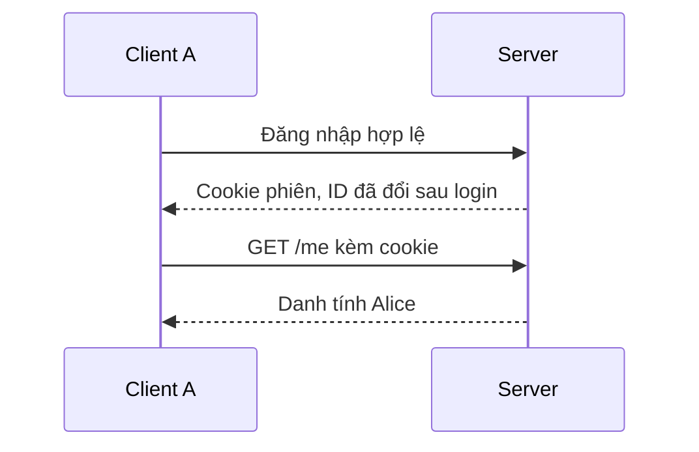
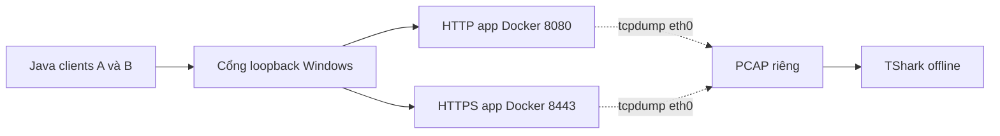

# KHUNG SLIDE — ATMMT NHÓM 05

**Ngày soạn:** 17/10/2026.<br>
**Đề tài:** Session Hijacking trên ứng dụng Spring Boot và các biện pháp bảo vệ phiên.<br>
**Định dạng:** nội dung Markdown để nhóm tạo slide, gồm 13 slide chính và 3 slide dự phòng.<br>
**Thời lượng giả định:** 10–12 phút trình bày và demo, chưa gồm hỏi đáp. Điều chỉnh theo yêu cầu giảng viên.

## Cách dùng file này

- Chỉ đưa phần **Nội dung trên slide** lên màn hình. Phần ghi chú dành cho người nói, không dán nguyên báo cáo vào slide.
- Mỗi slide có một ý chính. Dùng sơ đồ cho cơ chế, bảng cho so sánh và ảnh bằng chứng cho kết quả.
- Kết quả có sẵn thuộc lần chạy ngày **14/10/2026**. Nếu thay bằng kết quả mới, cập nhật đồng bộ ngày, run ID, số gói và hình.
- Không đưa session ID, CSRF token hoặc khóa/mật khẩu keystore lên slide. Ảnh hiện có đã che cookie.
- Chưa có ảnh DevTools/quay trực tiếp lúc bắt gói trong bộ bằng chứng cũ. Chỉ bổ sung tuyên bố đó sau khi nhóm thực sự làm.

**Gợi ý hình thức:** tỷ lệ 16:9, nền sáng, chữ tối và xanh đậm làm màu nhấn theo ứng dụng. Dùng Arial hoặc font có đầy đủ tiếng Việt, tiêu đề khoảng 32 pt và nội dung 20–24 pt. Đặt nguồn/ngày dưới hình kết quả. Đây là gợi ý khi dựng slide, không phải nội dung trên slide.

### Thứ tự người nói

| Thành viên | Đoạn đề xuất | Thời lượng |
|---|---|---|
| Người 1 | Slide 1–4: mục tiêu, cookie/session và ứng dụng | Khoảng 2–3 phút |
| Người 3 | Slide 5–7 và 10: lab, bằng chứng mạng, chạy demo | Khoảng 4 phút, gồm thời gian chờ script |
| Người 2 | Slide 8–9 và 11–12: phòng vệ, vòng đời, tổng hợp và giới hạn | Khoảng 3–4 phút |
| Cả nhóm | Slide 13 và hỏi đáp, dùng slide dự phòng khi cần | Theo thời gian còn lại |

Thứ tự nói thực tế theo thứ tự slide; người 3 quay lại ở slide 10. Trong 75 giây script chờ timeout, có thể giải thích các biện pháp/vòng đời để tránh đứng chờ. Xem [hướng dẫn demo](HUONG_DAN_DEMO_NHOM05.md) để chuẩn bị trước.

---

## Slide 01 — Session Hijacking trên ứng dụng Spring Boot

### Nội dung trên slide

**Tìm hiểu, mô phỏng và đánh giá các biện pháp bảo vệ phiên đăng nhập**

- Môn: An toàn mạng máy tính
- Nhóm 05
- Thành viên: [bổ sung họ tên và MSSV]
- Giảng viên, lớp học phần: [bổ sung]

### Gợi ý hình

Một hình nhỏ thể hiện hai client truy cập ứng dụng ghi chú. Không dùng ảnh tấn công hệ thống thật hoặc cookie đang hoạt động để trang trí.

### Ghi chú người nói

Nhóm nghiên cứu phiên đăng nhập dùng cookie trên ứng dụng Java/Spring Boot do nhóm tự xây dựng. Phần thực hành chỉ dùng tài khoản giả và môi trường cục bộ.

### Nguồn

[Báo cáo — giới thiệu](ATMMT_nhom05.md#gioi-thieu).

---

## Slide 02 — Mục tiêu và phạm vi

### Nội dung trên slide

- Giải thích cách server nhận diện người dùng bằng cookie phiên
- Mô phỏng client B sử dụng phiên hợp lệ của A
- Đối chiếu HTTP với HTTPS và kiểm tra vòng đời phiên
- Phạm vi: tài khoản giả, loopback Windows và mạng Docker riêng

### Gợi ý hình

Hai cột nhỏ “Quan sát” và “Môi trường”: cookie, danh tính, logout/timeout ở cột đầu; hai Java clients và hai app HTTP/HTTPS ở cột sau.

### Ghi chú người nói

Thí nghiệm cần chỉ ra cả nguồn cookie lẫn tác động khi client B dùng cookie đó. Với HTTPS, nhóm tách tình huống cookie đã lộ tại endpoint để không nhầm với việc lấy được cookie từ lưu lượng TLS.

### Nguồn

[Báo cáo — giới thiệu](ATMMT_nhom05.md#gioi-thieu), [kịch bản](ATMMT_nhom05.md#kich-ban).

---

## Slide 03 — Cookie liên kết client với session phía server

### Nội dung trên slide

- Cookie mang mã định danh phiên
- Server lưu trạng thái xác thực trong session
- Request tiếp theo gửi cookie để server khôi phục danh tính
- Client khác có cookie hợp lệ có thể được nhận diện là chủ phiên

### Gợi ý hình

Vẽ lại sơ đồ sau bằng các đối tượng chỉnh sửa được trong slide:



### Ghi chú người nói

Trong ứng dụng này, cookie không chứa toàn bộ hồ sơ người dùng hoặc mật khẩu. Server dùng ID để tìm trạng thái phiên đã xác thực. Vì vậy bảo vệ mật khẩu và bảo vệ phiên là hai việc cùng cần thực hiện.

### Nguồn

[Báo cáo — cơ sở](ATMMT_nhom05.md#co-so).

---

## Slide 04 — Ứng dụng ghi chú và phân quyền dữ liệu

### Nội dung trên slide

- Java 17, Spring Boot 4.1.1, Spring Security và Thymeleaf
- `/login`, `/me`, `/notes`, POST `/logout`
- Alice và Bob có ghi chú riêng, chỉ đọc
- Server chọn dữ liệu bằng principal đã xác thực

### Gợi ý hình

Một sơ đồ gọn: Client, Spring Security, PageController, NoteService. Có thể chụp trang `/me` hoặc `/notes` từ lần demo mới, không chụp cookie/token. Ảnh trang ứng dụng chưa nằm trong ba ảnh kết quả có sẵn.

### Ghi chú người nói

Thử `/notes?username=bob` bằng phiên Alice vẫn chỉ thấy ghi chú Alice. JavaScript tìm kiếm chỉ lọc dữ liệu server đã cấp, không đảm nhiệm phân quyền. Hai tài khoản và ghi chú nằm trong bộ nhớ, chưa cần database cho lab.

### Nguồn

[Báo cáo — thiết kế](ATMMT_nhom05.md#thiet-ke), [PageController](../src/main/java/vn/edu/atmmt/sessionlab/web/PageController.java).

---

## Slide 05 — Điểm bắt gói trong Docker

### Nội dung trên slide

- Hai Java clients có kho cookie riêng
- HTTP ở cổng 8080, HTTPS ở cổng 8443
- tcpdump bắt tại `eth0` trong network namespace của app
- TShark phân tích PCAP offline, không có khóa giải mã TLS

### Gợi ý hình



### Ghi chú người nói

Container HTTPS xử lý TLS tại Tomcat, nên điểm bắt gói này vẫn quan sát dữ liệu TLS trước khi ứng dụng giải mã. Đây là mạng lab của nhóm. Nhóm không thực hiện ARP spoofing hoặc bắt Npcap trên Windows loopback trong lần chạy đã ghi.

### Nguồn

[Báo cáo — môi trường](ATMMT_nhom05.md#moi-truong).

---

## Slide 06 — Cookie từ HTTP PCAP xác thực được client B

### Nội dung trên slide

1. B chưa có phiên: server yêu cầu đăng nhập
2. A đăng nhập Alice và tạo request HTTP chứa cookie
3. TShark trích cookie từ PCAP đúng marker của lần chạy
4. B gửi cookie đã trích và server nhận diện Alice

**T01, T03 và T02 đạt trong lần thực nghiệm 14/10/2026.**

### Gợi ý hình

Sử dụng [ảnh kết quả HTTP](minh-chung/phan3/run-063d980c01c2/frame-01.jpg). Hoặc dựng chuỗi 4 bước với trích đoạn từ bảng gói đã che. Nếu dùng ảnh toàn slide thì không thêm lại các đoạn chữ trùng trong ảnh.

### Ghi chú người nói

Cookie B dùng ở lần thực nghiệm đến từ file TShark trích, không lấy trực tiếp từ cookie jar của A. T03 diễn ra trước T02 dù số mã nhỏ hơn. Frame 22 chỉ thuộc PCAP seed của lần chạy cũ, không phải số frame cố định.

### Nguồn

[Events T01/T03/T02](minh-chung/phan3/run-063d980c01c2/events.tsv), [bảng gói](minh-chung/phan3/run-063d980c01c2/packets-redacted.tsv).

---

## Slide 07 — HTTPS bảo vệ cookie trên đường truyền

### Nội dung trên slide

| HTTP trong lab | HTTPS trong lab |
|---|---|
| TShark đọc được `http.cookie` | Không giải mã ra header cookie khi thiếu khóa TLS |
| B dùng cookie trích từ PCAP | T06 dùng cookie đã biết tại endpoint |
| Thể hiện đường lộ qua HTTP | Thể hiện giới hạn khi cookie đã lộ từ nguồn khác |

**T04 và T06 cùng đạt, phản ánh hai điều kiện thí nghiệm khác nhau.**

### Gợi ý hình

Sử dụng [ảnh đối chiếu HTTPS](minh-chung/phan3/run-063d980c01c2/frame-02.jpg) hoặc bảng hai cột. Nếu dùng số liệu, chú thích ngày 14/10/2026 và run ID.

### Ghi chú người nói

Lần cũ đàm phán TLS 1.3, có 83 frame chứa bản ghi TLS và 59 frame chứa loại ngoài 23. Với TLS 1.3, loại ngoài 23 có thể chứa handshake đã mã hóa, nên 59 không phải số request HTTP. Cookie HTTPS của T06 không được trích từ PCAP TLS.

### Nguồn

[Báo cáo — kết quả](ATMMT_nhom05.md#ket-qua), [events T04/T06](minh-chung/phan3/run-063d980c01c2/events.tsv).

---

## Slide 08 — Các biện pháp bảo vệ phiên

### Nội dung trên slide

| Biện pháp | Khâu được bảo vệ |
|---|---|
| HTTPS | Dữ liệu truyền giữa client và server được xác minh |
| Secure | Gửi cookie theo quy tắc kênh bảo mật của trình duyệt |
| HttpOnly | Hạn chế JavaScript đọc cookie trực tiếp |
| SameSite=Lax và CSRF token | Hạn chế một số request khác site và kiểm tra token ở thao tác được bảo vệ |
| Đổi ID, logout, timeout | Quản lý thời điểm và hiệu lực của phiên |

### Gợi ý hình

Bảng phẳng, chữ lớn. Nếu chật, bỏ hàng đổi ID/logout/timeout vì slide tiếp theo giải thích riêng. Không dùng biểu tượng “an toàn tuyệt đối”.

### Ghi chú người nói

Cookie HTTPS dùng tiền tố `__Host-`, Secure, Path=/ và không phát Domain. Kiểm tra header xác nhận server phát các thuộc tính đó, chưa kiểm chứng đầy đủ chính sách cookie khác site trong trình duyệt. HttpOnly không chặn mọi tác động của XSS và SameSite không thay toàn bộ bảo vệ CSRF.

### Nguồn

[Báo cáo — bảo vệ](ATMMT_nhom05.md#bao-ve).

---

## Slide 09 — Hiệu lực phiên sau login, logout và timeout

### Nội dung trên slide

| Sự kiện | Quan sát |
|---|---|
| Login | ID đổi ở cả HTTP và HTTPS, T09 |
| Logout hợp lệ | Client gốc và client giữ bản sao mất quyền, T07 |
| 75 giây không request ở HTTPS | Hai client phải login lại, T08 |

**Timeout HTTPS cấu hình 60 giây không hoạt động.**

### Gợi ý hình

[Ảnh vòng đời phiên](minh-chung/phan3/run-063d980c01c2/frame-03.jpg), hoặc bảng kết quả với fingerprint rút gọn. Không hiển thị ID đầy đủ.

### Ghi chú người nói

Logout phải hủy trạng thái phía server, chỉ xóa cookie của một client chưa đủ. Timeout không phải tuổi thọ tuyệt đối vì request hợp lệ có thể giữ phiên sống. Đổi ID khi login hỗ trợ chống fixation nhưng cookie mới sau login vẫn cần được bảo vệ.

### Nguồn

[Events T07/T08/T09](minh-chung/phan3/run-063d980c01c2/events.tsv), [fingerprint](minh-chung/phan3/run-063d980c01c2/session-fingerprints.tsv).

---

## Slide 10 — Demo trực tiếp

### Nội dung trên slide

- Ứng dụng: Alice, Bob và ghi chú theo principal
- Thực nghiệm: cookie HTTP từ PCAP và phản hồi của B
- Vòng đời: logout, thời gian không hoạt động và kết quả TLS

### Gợi ý hình

Slide chỉ báo nội dung sắp trình diễn. Chuyển sang trình duyệt và terminal đã chuẩn bị; không chèn nhiều ảnh chụp terminal có chữ nhỏ.

### Ghi chú người nói và thao tác

Trước buổi trình bày, build cả hai app và image công cụ, tạo/tin cậy đúng chứng chỉ. Trong demo, ở PowerShell tại `session-hijacking-lab`:

```powershell
.\scripts\part3\Run-Part3.ps1
```

Chỉ các dòng PASS quan trọng, giải thích khoảng chờ 75 giây và đợi `COMPLETE`. Nhóm có thể chạy script từ lúc bắt đầu giải thích slide 8 để tận dụng thời gian, rồi quay lại terminal ở slide 10. Không gọi demo đạt nếu chương trình dừng giữa chừng.

Nếu dùng báo cáo/video cũ thay cho live, nói rõ đây là kết quả ngày 14/10. Video 24 giây trình bày lại kết quả đã ghi. Quy trình mở app, thao tác DevTools tùy chọn và phương án dự phòng có trong hướng dẫn demo.

### Nguồn

[Hướng dẫn demo](HUONG_DAN_DEMO_NHOM05.md), [video dự phòng](minh-chung/phan3/run-063d980c01c2/demo-ket-qua.mp4).

---

## Slide 11 — Tổng hợp kết quả đã ghi

### Nội dung trên slide

| Bộ kiểm chứng | Kết quả đã ghi | Phạm vi |
|---|---|---|
| JUnit HTTP | 13 kiểm tra đạt | Đăng nhập, phân quyền, CSRF và session |
| Java HTTPS | 24 kiểm chứng đạt | TLS, cookie và vòng đời phiên |
| Thực nghiệm PCAP | T01–T09 đạt | Nguồn cookie HTTP và đối chiếu TLS |

**Bằng chứng ngày 14/10/2026. Mỗi bộ có phạm vi riêng.**

### Gợi ý hình

Bảng 3 dòng. Không cộng 13 + 24 + 9 thành một tổng test độc lập. Nếu đã chạy lại trước bảo vệ, thay phần ngày/kết quả bằng kết quả thật cùng bằng chứng mới.

### Ghi chú người nói

Kết quả HTTP client mô tả phản hồi ứng dụng. PCAP bổ sung bằng chứng dữ liệu quan sát trên mạng tại điểm bắt cụ thể. Các phép thử Java không tự xác nhận hành vi giao diện hay mọi chính sách trình duyệt.

### Nguồn

[Log HTTP](minh-chung/kiem-chung-http.txt), [log HTTPS](minh-chung/kiem-chung-https.txt), [events PCAP](minh-chung/phan3/run-063d980c01c2/events.tsv).

---

## Slide 12 — Kết luận và giới hạn

### Nội dung trên slide

- Lộ cookie còn hiệu lực có thể dẫn đến dùng lại phiên
- HTTPS bảo vệ đường truyền, còn vòng đời phiên cần quản lý phía server
- Logout và timeout làm bản sao cookie mất quyền trong các phép thử
- Phạm vi: một máy Windows, mạng Docker riêng và Java clients

**Cần bổ sung:** xác nhận trên máy khác, quan sát DevTools và kiểm tra trình duyệt khác site nếu yêu cầu mở rộng.

### Gợi ý hình

Hai vùng “Kết luận từ thực nghiệm” và “Giới hạn”. Chỉ giữ các kết luận có bằng chứng, không dùng dấu tick cho nội dung chưa làm.

### Ghi chú người nói

Nhóm chưa kiểm chứng nghe lén LAN, chống mọi XSS/CSRF hoặc khả năng vận hành production. PCAP gốc giữ riêng; báo cáo công khai che cookie và có hash để đối chiếu. Các giới hạn giúp xác định đúng phạm vi kết luận.

### Nguồn

[Báo cáo — phân tích](ATMMT_nhom05.md#phan-tich), [kết luận](ATMMT_nhom05.md#ket-luan).

---

## Slide 13 — Tài liệu và mã nguồn

### Nội dung trên slide

- Repository: `github.com/HieuDao1410/ATMMT`
- Báo cáo: `ATMMT_nhom05.md`
- Nguồn kỹ thuật: OWASP Session Management, Spring Security, Wireshark/TShark
- Bằng chứng và hướng dẫn chạy nằm trong repository

### Gợi ý hình

Đặt link repository đủ lớn để đọc. Có thể tự tạo QR từ URL khi dựng slide. Không nhúng link chứa cookie, token hoặc đường dẫn nội bộ riêng.

### Ghi chú người nói

Mời giảng viên xem source, log đã che và cách chạy lại. Sau slide này, mở slide dự phòng theo câu hỏi thay vì trình bày hết.

### Nguồn

[Danh sách nguồn kỹ thuật trong báo cáo](ATMMT_nhom05.md#tham-khao), [repository](https://github.com/HieuDao1410/ATMMT).

---

## Dự phòng 14 — Session Hijacking, Session Fixation và CSRF

### Nội dung trên slide

| Khái niệm | Cơ chế trọng tâm |
|---|---|
| Session Hijacking trong lab | B sử dụng ID của phiên đã xác thực còn hiệu lực |
| Session Fixation | ID đã biết trước login cần được thay khi xác thực |
| CSRF | Request thay đổi trạng thái thiếu ý định hợp lệ của người dùng, được kiểm tra bằng token trong ứng dụng |

### Ghi chú người nói

CSRF token không tự làm cookie đã lộ mất hiệu lực. Nếu người giữ cookie truy cập được form trong cùng phiên, họ có thể nhận token tương ứng. Các kiểm chứng thiếu/sai token vẫn cần để bảo vệ đúng luồng login/logout.

### Nguồn

[Cơ sở và bảo vệ trong báo cáo](ATMMT_nhom05.md#co-so), [test case H06–H08, H11](TEST_CASES_NHOM05.md).

---

## Dự phòng 15 — Test case và cách chạy lại

### Nội dung trên slide

```powershell
.\mvnw.cmd test
java scripts/VerifyHttpsLab.java .local/tls/localhost.cer
.\scripts\part3\Run-Part3.ps1
```

- Chuẩn bị Docker, chứng chỉ và image công cụ trước khi chạy
- Ghi môi trường, commit, thời gian và run ID
- Chỉ đánh PASS sau khi quan sát đầy đủ kết quả

### Ghi chú người nói

38 tình huống trong tài liệu kiểm thử gồm 13 HTTP, 10 nhóm HTTPS, 6 giao diện và T01–T09. Số tình huống tài liệu khác số assertion tự động. Nếu bị chặn bởi môi trường, ghi BLOCKED thay vì sửa kết quả mong đợi.

### Nguồn

[TEST_CASES_NHOM05.md](TEST_CASES_NHOM05.md), [hướng dẫn chạy demo](HUONG_DAN_DEMO_NHOM05.md).

---

## Dự phòng 16 — Giải thích số liệu TLS và bằng chứng

### Nội dung trên slide

- Run cũ: `run-063d980c01c2`, ngày 14/10/2026
- HTTP ghép: 70 gói, 10 request được giải mã
- HTTPS: 200 gói, 83 frame chứa TLS, 59 frame có loại ngoài 23
- Header cookie giải mã từ TLS: 0

### Ghi chú người nói

Số frame chứa TLS không phải số request HTTP. Điều kiện T04 gồm kiểm tra có lưu lượng TLS thật, không có khóa giải mã, không giải mã ra header cookie và chuỗi cookie đã biết không xuất hiện trong byte PCAP. Hash SHA-256 liên kết file PCAP riêng với manifest; bảng đã che không thay thế bản gốc. Số liệu thay đổi khi chạy lại.

### Nguồn

[Bảng gói](minh-chung/phan3/run-063d980c01c2/packets-redacted.tsv), [manifest](minh-chung/phan3/run-063d980c01c2/capture-manifest.json), [thống kê capture](minh-chung/phan3/run-063d980c01c2/capture-statistics.txt).
